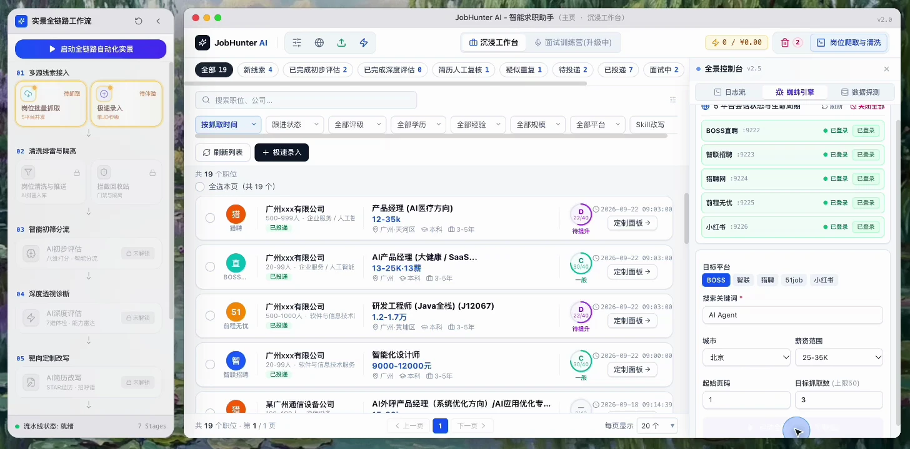
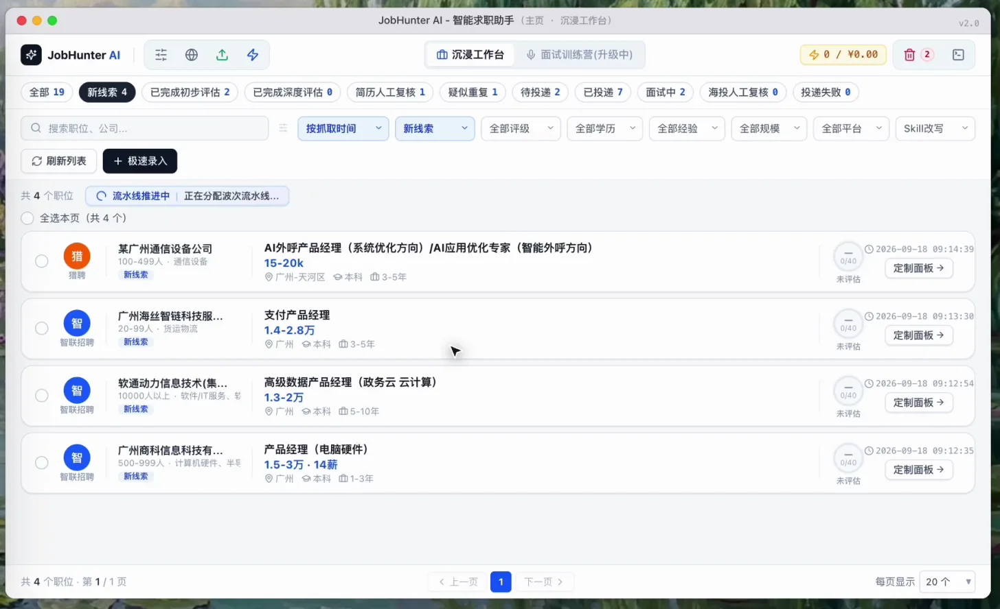
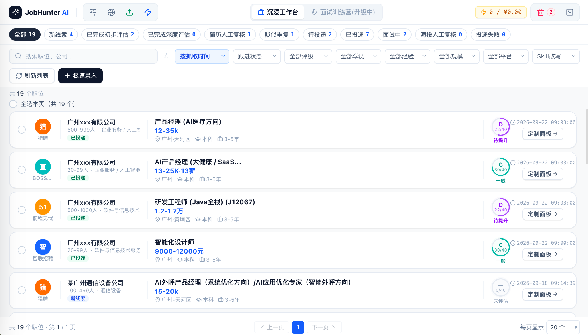
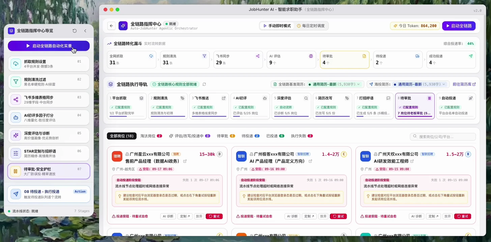
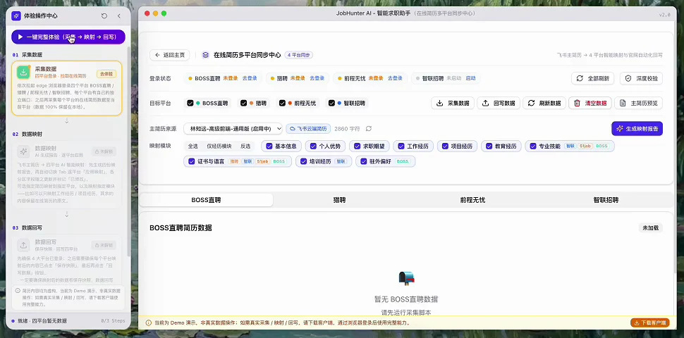
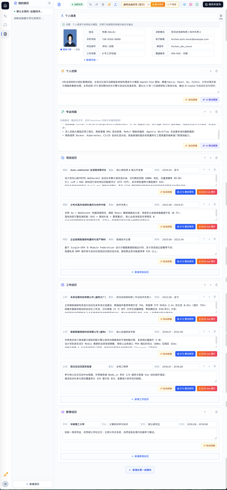
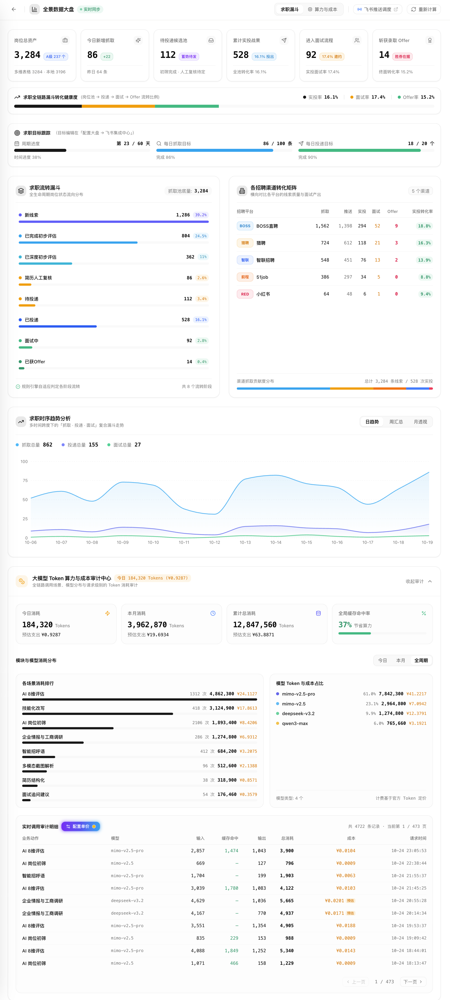

<div align="center">

#  JobHunter

### 自动化求职智能助手
**24/7 个人求职助手 · 自动化全景巡航 · 简历精准改写 · AI 专家深度诊断 · 飞书 ChatOps 全程联动**

<p align="center">
  <a href="./LICENSE"></a>
  <a href="https://github.com/jolie-z/jobhunter-ai"></a>
  <a href="https://nextjs.org"></a>
  
  
  <a href="#feishu-community"></a>
  
</p>

<!-- 顶部核心导航 (按需求排序与跳转) -->
<p align="center">
  <a href="https://jobhunter.joliezeng.top/#demo">🎮 <b>项目 Demo 体验</b></a> &nbsp;•&nbsp;
  <a href="https://jobhunter.joliezeng.top/guide/pipeline">📖 <b>使用指南</b></a> &nbsp;•&nbsp;
  <a href="#download">💻 <b>客户端下载</b></a> &nbsp;•&nbsp;
  <a href="#feishu-community">👥 <b>飞书交流群</b></a>
</p>

<!-- 核心板块快速直达锚点 -->
<p align="center">
  <a href="#download">📦 下载安装</a> &nbsp;|&nbsp;
  <a href="#combat-room">四分屏全景</a> &nbsp;|&nbsp;
  <a href="#showcase">实景动图</a> &nbsp;|&nbsp;
  <a href="#comparison">效能对比</a> &nbsp;|&nbsp;
  <a href="#features">核心能力</a> &nbsp;|&nbsp;
  <a href="#platform-support">平台支持</a> &nbsp;|&nbsp;
  <a href="#tech-stack">技术栈</a> &nbsp;|&nbsp;
  <a href="#architecture">系统架构</a> &nbsp;|&nbsp;
  <a href="#quickstart">快速开始</a> &nbsp;|&nbsp;
  <a href="#configuration">配置说明</a> &nbsp;|&nbsp;
  <a href="#privacy">隐私守卫</a>
</p>

---

</div>

> 🎮 **在线体验**：推荐先前往 **[项目 Demo 体验](https://jobhunter.joliezeng.top/#demo)**，在线交互式漫游完整求职作战流程。  
> 💻 **真实使用**：请前往 **[客户端下载](#download)**（支持 Windows / macOS），安装完成即可开箱即用！  
> 📖 **新手起步**：参阅 **[使用指南](https://jobhunter.joliezeng.top/guide/pipeline)** 配置大模型 API Key 并连接飞书，即可立即启动全自动求职。

<a id="download"></a>
## 📦 下载桌面客户端（v0.3.7）

| 平台 | 安装包 |
| :--- | :--- |
| 🪟 **Windows x64**（Win10 / Win11） | **[⬇️ 下载 Windows 安装包 .exe](https://github.com/jolie-z/jobhunter-ai/releases/latest/download/JobHunter.Windows.x64.0.3.7.exe)** |
| 🍎 **macOS Apple Silicon**（M 系列） | **[⬇️ 下载 macOS 安装包 .dmg](https://github.com/jolie-z/jobhunter-ai/releases/latest/download/JobHunter-mac-arm64.dmg)** |

> 💡 下载链接始终指向最新版本；更新日志见 **[Releases 页面](https://github.com/jolie-z/jobhunter-ai/releases)**。
> 🍎 macOS 首次打开若提示「无法验证开发者」：在「应用程序」目录右键 JobHunter → 打开 → 再点打开。

<a id="why-jobhunter"></a>
## <span style="color: #3b82f6;">Why</span> <span style="color: #06b6d4;">JobHunter</span>？

在当下高烈度的求职招聘市场，**“一份简历投天下”的初筛通过率已不足 3%**，而手动搜索各平台、逐条分析 JD、针对性重写简历、应付 HR 招呼语、记录各渠道投递进度，每天需要消耗 4~6 小时无意义的重复精力。

> 🧬 本项目是开源求职项目 **[Auto-JobHunter](https://github.com/jolie-z/Auto-JobHunter)**（⭐ 80+）的全面升级与重构版本。

**JobHunter** 从底层重构了个人的求职生产力工作流：它不是简单的自动点击器，而是一套**基于 LangGraph 状态机驱动的端到端自动化作战系统**。它如同为你配备了一位 24 小时待命的私人求职参谋与助理团队，从全网岗位巡航挖掘、双层智能清洗过滤、AI 专家匹配度诊断、动态 STAR 经历改写，到手机飞书远程审批放行与多平台在线简历自动回写，形成全自洽的闭环。

---

<a id="combat-room"></a>
## 🖥️ 独创四分区联动作战室

> 告别多窗口手忙脚乱。JobHunter 独创**四分区自由联动工作台**：将求职全流程解构为【岗位详情】、【简历编辑】、【简历诊断】、【面试资料】4 大核心功能分区，支持根据你的屏幕与使用习惯自由组合、按需切换视口：

<p align="center">
  
  <br>
  <em>🎯 <b>四分区按需联动</b>：4 大模块随时自由组合（左栏【岗位画像存档】 ⇋ 中间【简历靶向改写】 ⇋ 右栏【AI 专家深度诊断 / 岗位专属面试资料】），灵活收放与切换视口，告别僵硬平铺</em>
</p>

---

<a id="showcase"></a>
## 🎬 全景界面与动态演示

### 1. 多平台智能巡航与极速岗位录入（支持文本复制与截图粘贴）
> **四大平台一键巡航抓取**：一键拉起 BOSS直聘、猎聘、51job、智联招聘后台抓取，实时任务队列可视化，自动排重清洗入库：
<p align="center">
  
</p>

> **极速零摩擦岗位录入**：除了四大平台后台自动巡航，更支持碎片化岗位随时录入——直接粘贴岗位文本、拖入招聘截图或微信聊天图片，AI 秒级结构化抽取 JD 画像入库：
<p align="center">
  
</p>

---

### 2. 沉浸工作台 · 批量评估与智能编排
> 批量选择目标岗位，一键调用大模型执行深度画像诊断，悬浮操作栏支持批量审批与状态流转：
<p align="center">
  
</p>

<p align="center">
  
  <br>
  <em>📋 <b>岗位全景看板</b>：支持按抓取时间、评级梯度、平台来源等多维筛选，状态胶囊实时统计</em>
</p>

---

### 3. 全链路指挥中心 · 转化漏斗与模型矩阵
> 从抓取、清洗、评估、改写、审批到最终投递，全流程 9 大阶段自动巡航，支持 DeepSeek-v4.1 flash、mimo v2.6 flash等国产大模型矩阵推理：
<p align="center">
  
</p>

---

### 4. 在线简历多平台自动回写与数据映射
> 告别在各招聘网站反复填写的痛苦。端侧解析主简历后，全自动匹配回写至 BOSS、猎聘、51job、智联四大平台后台：
<p align="center">
  
</p>

---

### 5. 智能简历工作台与 STAR 深度定制
> 结构化简历母本管理，支持通用官方剧本与行业特化定制，经历一键自动排版：
<p align="center">
  
  <br>
  <em>✍️ <b>智能简历工作台</b>：支持 STAR 量化生成、@ ATS 关键词靶向对齐、考官视角 Grill-me 拷打与产物库归档</em>
</p>

---

### 6. 全景数据大盘与 Token 成本审计
> 资产总览、多渠道转化矩阵、时序投递趋势图以及每笔 API 调用的毫厘审计：
<p align="center">
  
  <br>
  <em>📈 <b>全景数据大盘</b>：清晰掌握各渠道 ROI、漏斗瓶颈与算力开销</em>
</p>

---

### 7. 飞书集成中心与 ChatOps 交互
> 免公网穿透长连接接入，每日定时推送高质感群战报，支持移动端直接点击放行：
<p align="center">
  
  <br>
  <em>📱 <b>飞书移动端协同</b>：随时随地查看推送战报，一键核准投递意向</em>
</p>

---

<a id="comparison"></a>
## ⚖️ 传统求职 vs JobHunter

| 维度 | 传统手动海投 | 传统脚本/点击器 | JobHunter 智能平台 |
| :--- | :--- | :--- | :--- |
| **覆盖渠道** | 逐个平台手动刷新切换 | 单一平台容易遭反爬风控 | **BOSS / 猎聘 / 51job / 智联** 四大平台协同巡航 |
| **简历策略** | 一份通用简历到处投（秒挂） | 固定几套模版简单套用 | **针对目标岗位 JD 实时大模型重构**，动态注入量化 STAR 经历 |
| **岗位过滤** | 人肉翻阅低效信息海 | 仅支持单一关键词硬匹配 | **Tier 1 物理硬筛 + Tier 2 AI 侦察兵排雷**（隐性外包/销售/对赌逐字排雷） |
| **投递质量** | 精投耗时极长，海投千篇一律 | 无脑群发垃圾投递易封号 | **A/B 级深度定向精投 + C / D 级海投安检防撞门槛 + 人工审批双保险** |
| **资产同步** | 毫无进度记录或依赖手动 Excel | 产生本地死数据无法跨端 | **双向无缝打通飞书多维表格**，手机群控 ChatOps 秒级指令流转 |

---

<a id="features"></a>
## ✨ 核心能力

| 模块 | 说明 |
| :--- | :--- |
| 🕷️ 多平台爬虫 | BOSS 直聘、前程无忧（51job）、猎聘、智联招聘四大平台岗位抓取，基于 Playwright + 持久化浏览器 Profile 保持登录态 |
| 🧹 数据清洗引擎 | Tier1 硬规则过滤 + Tier2 AI 初筛打分，全链路模块复用的统一核心组件 |
| 🧠 AI 评估与改写 | LangGraph 状态机驱动的评估→改写/快速话术→审批→投递流水线，支持 A/B 级深度改写与 C-F 级海投话术 |
| 🚀 自动投递 | 简历改写后精准投递 + 海投简历批量投递（mass_apply），平台级并发守卫防反爬 |
| 💬 飞书 ChatOps | 在飞书聊天框用自然语言下达指令（抓取/清洗/评估/推送/查库），LLM 意图解析 + SSE 实时日志流 |
| 🤖 飞书 ChatAgent | 对话式求职助理：持久会话记忆（跨重启续接）、交互卡片、公司情报（表格缓存 + Serper/Tavily 实时搜索）、简历微调闭环；红线：绝不自动/批量投递。实验性功能，计划 v1.0 正式发布 |
| 📊 飞书多维表格 | 岗位线索、简历库、求职偏好、面试报告等多维表格双向同步（带防重复查重） |
| 📝 简历编辑器 | V2 可视化简历编辑 + 四平台在线简历回写（BOSS/猎聘/51job/智联）与映射报告 |
| 🎤 面试训练营 | 模拟面试（WebSocket + TTS）、面经粉碎、公司背调（Serper/Tavily 搜索） |

---

<a id="platform-support"></a>
## 🧪 平台支持状态

| 平台 | 岗位抓取 | 自动投递 | 简历回写 | 状态 |
| :--- | :---: | :---: | :---: | :--- |
| BOSS 直聘 | ✅ | ✅ | ✅ | 核心平台，持续真机验证 |
| 前程无忧 51job | ✅ | ✅ | ✅ | 核心平台，持续真机验证 |
| 猎聘 | ✅ | ✅ | ✅ | 核心平台，持续真机验证 |
| 智联招聘 | ✅ | ✅ | ✅ | 核心平台，持续真机验证 |

> 招聘平台页面改版与风控升级可能造成功能间歇性失效，适配更新随版本发布；遇到问题欢迎提 issue。

---

<a id="tech-stack"></a>
## 🏗️ 技术栈

- **后端**：FastAPI · LangGraph · DrissionPage + Playwright（CDP）· SQLite（岗位主库）· APScheduler · Python 3.10–3.13（uv 管理）
- **前端**：Next.js (App Router) · Tailwind CSS v4 · shadcn/ui · Zustand · Vitest · ESLint
- **集成**：飞书开放平台（多维表格 + 机器人 + ChatOps）· LLM（OpenAI 兼容接口）· Tavily 搜索 · Sentry
- **部署**：宿主机常驻（uvicorn + Next.js；爬虫依赖真实浏览器环境，不可容器化）

---

<a id="architecture"></a>
## 🏗️ 系统架构

```
┌─────────────────────────────────────────────────────────────────────────────┐
│                            JobHunter 统一架构体系                           │
└─────────────────────────────────────────────────────────────────────────────┘

  【外部平台接入层】
     ├── BOSS 直聘         ├── 猎聘网           ├── 前程无忧 (51job)   ├── 智联招聘
     └── 飞书开放平台 (WebSocket 长连接免穿透 + Bitable 多维表格双向同步)

  【执行与爬虫引擎】
     ├── Chromium CDP 浏览器引擎 (独立持久化 Profile · 扫码登录态持久保持)
     ├── 异步爬虫编排 (自适应限流 · 智能去重 · 平台反爬频率抖动保护)
     └── 在线简历多平台自动回写驱动 (DOM 注入 · 表单差量更新)

  【核心流水线与状态机编排】
     ├── 前置巡航与清洗流水线
     │    ├── Step 1: 平台抓取 (BOSS / 猎聘 / 51job / 智联四大招聘平台巡航与多渠道录入)
     │    ├── Step 2: 规则清洗 (Tier 1 物理规则硬过滤 + Tier 2 AI 侦察兵 LLM 语义排雷)
     │    └── Step 3: 飞书推送 (多维表格新线索秒级双向同步建档)
     └── 核心决策与交付状态机 (基于 LangGraph 编排 5 节点决策闭环)
          ├── [evaluate 节点] Step 4 初评 (8维40分量化) + Step 5 深度评估 (考官画像雷达)
          ├── [rewrite 节点] Step 6 简历改写 (针对目标岗位 JD 实时重构 · STAR 量化经历)
          ├── [quick_greeting 节点] Step 7 打招呼语 (基于候选人画像，生成个性化开场白)
          ├── [wait_approval 节点] Step 8 待审批 (飞书富交互卡片 / 桌面工作台双路放行闸门)
          └── [deliver 节点] Step 9 自动投递 (平台白名单安全投递 · 拟人频率随机抖动)

  【展示与交互控制层】
     ├── Next.js 现代化前端 (四分屏联动作战室 / 沉浸工作台 / 配置大盘)
     ├── 全景数据分析大盘 (漏斗分析 · 渠道ROI · Token 成本与算力审计)
     └── 飞书 ChatOps 指挥中心 (自然语言交互群控 · 移动端定时战报)
```

---

<a id="project-structure"></a>
## 📁 项目结构

```
jobhunter-ai/
├── backend/                  # FastAPI 后端
│   ├── app/                  # 核心应用（API 路由、自动化流水线、ChatOps、设置）
│   │   ├── automation/       # LangGraph 流水线 + 调度器 + 平台守卫
│   │   ├── api/routes/       # chatops / webhook / crawlers 等路由
│   │   └── core/             # 配置、LLM 客户端、飞书客户端、PDF 渲染
│   ├── boss_scraper/         # BOSS 直聘爬虫
│   ├── 51job_scraper/        # 前程无忧爬虫 + 海投
│   ├── liepin_scraper/       # 猎聘爬虫
│   ├── zhilian_scraper/      # 智联招聘爬虫
│   ├── job_processor/        # 清洗流水线（step1 规则过滤 / step2 飞书同步）
│   ├── ai_agents/            # AI 评估、改写、打招呼语生成
│   ├── resume_editor/        # 四平台简历回写引擎
│   └── data/                 # 浏览器 Profile（登录态）与 SQLite 数据库
├── frontend/                 # Next.js 前端（简历编辑器、流水线看板、策略实验室、全链路指挥中心）
├── scripts/                  # 运维脚本（配置验证、GitHub 流量归档）
└── docs/                     # 长期文档（含已弃用的 docker-archive）
```

---

<a id="quickstart"></a>
## 🚀 快速开始

> 如果你是第一次接触 GitHub 开源项目，或者不知道如何配置 Python/Node 环境：
> - 🤖 **直接把仓库链接发给 AI**：复制本仓库地址 `https://github.com/jolie-z/jobhunter-ai` 发送给你常用的任意 AI（DeepSeek / ChatGPT / 豆包 / Kimi / Claude 等），对它说：  
>   *“我想使用这个开源项目，请根据它的 README，一步一步教我在我的电脑（Windows 或 Mac）上安装并运行起来。”*
> - 📦 **下载的安装包/压缩包也一样**：遇到任何看不懂的报错、缺依赖提示或解压问题，直接截图发给 AI，它会充当你的 7×24h 私人技术导师，手把手带你排错并拉起项目。
> - 💻 **不想折腾代码与环境？** 推荐直接前往 **[客户端下载](#download)** 获取 Windows / macOS 原生安装包，安装完成开箱即用！

---

### 运行环境准备

- **操作系统**：macOS / Windows / Linux
- **Python**：3.10–3.13（推荐 3.12；暂不支持 3.14）· 推荐 [uv](https://docs.astral.sh/uv/)
- **Node.js**：18+
- **Microsoft Edge 浏览器（必需）**：四大平台的岗位抓取与自动投递均通过 CDP 接管真实 Edge（持久化 Profile + 登录态）；未安装 Edge 时，岗位抓取与自动投递无法运行

---

### 本地部署与启动

#### 1. 克隆代码仓库
```bash
git clone https://github.com/jolie-z/jobhunter-ai.git
cd jobhunter-ai
```

#### 2. 启动后端服务 (FastAPI)
```bash
cd backend

# 安装项目依赖（使用 uv 极速安装）
uv sync

# 复制环境变量配置文件
cp .env.example .env

# 安装 Playwright 浏览器内核支持
playwright install chromium

# 启动后端 API 服务（默认运行在 http://localhost:8000）
uvicorn app.main:app --reload --host 0.0.0.0 --port 8000
```

#### 3. 启动前端控制台 (Next.js)
```bash
cd ../frontend

# 安装前端依赖
npm install

# 启动本地开发服务（默认运行在 http://localhost:3000）
npm run dev
```

> 💡 **Windows 用户福利**：可以直接双击根目录下的 `start_all.bat`，脚本将自动检查依赖并一键拉起前后端服务。

---

### 生产部署（宿主机常驻）

> ⚠️ **本项目不支持 Docker 部署**：四大平台爬虫依赖真实 Edge 浏览器 + 持久化登录态 + 人工扫码/滑块介入，容器内 headless 浏览器指纹会触发平台风控（历史编排归档见 `docs/docker-archive/`）。

```bash
# 后端（生产模式，去掉 --reload）
cd backend && uvicorn app.main:app --host 0.0.0.0 --port 8000

# 前端（构建后启动）
cd frontend && npm run build && npm start
```

建议用 [pm2](https://pm2.keymetrics.io/) / launchd / supervisor 守护进程常驻，示例：

```bash
pm2 start "uvicorn app.main:app --host 0.0.0.0 --port 8000" --name jobhunter-api --cwd backend
pm2 start "npm start" --name jobhunter-web --cwd frontend
```

---

### 新机体检自检（首次启动推荐）

为了确保你的大模型 API、飞书凭证、平台登录态等配置全部就绪，推荐运行我们内置的一键诊断工具：

```bash
cd backend
uv run python scripts/newmachine_check.py
```
- 控制台将自动检测各项依赖与文件状态，并逐项输出指引。
- 一旦全部检查通过，你就可以在浏览器打开前端控制台，点击 **「启动全链路」** 开启你的全自动求职巡航！

---

### 飞书极速对接指南

想要体验在手机随时查看求职进展、接收战报并一键审批放行？

从多维表格模板一键复制保存、自建应用创建与机器人能力开启，到毫秒级免公网穿透 WebSocket 长连接订阅，手把手保姆级图文助你 5 分钟极速打通：👉 详细图文步骤请直接参阅 **[📖 飞书极速对接使用指南](https://jobhunter.joliezeng.top/guide/feishu)**（本地离线文档亦可参考 [docs/feishu-setup.md](docs/feishu-setup.md)）。

---

<a id="configuration"></a>
## ⚙️ 配置说明

后端采用 **pydantic-settings + `.env` + `settings.json` 双层配置**：`.env` 提供启动期默认值，运行时可在「策略实验室 → 系统底层配置」页面热更新（写入 `settings.json`，优先级更高）。页面保存后绝大多数配置**即时生效**（飞书长连接自动用新凭证重连、ChatAgent 自动重建），无需重启。

> 📚 **新手第一次接入飞书？请按 [docs/feishu-setup.md](docs/feishu-setup.md) 完整手册一步步来**（创建应用 → 权限 → 长连接 → 拉群 → 一键「检测连通性」→ ping 通），附排错 FAQ。

关键配置项：

| 分组 | 配置项 | 用途 |
| :--- | :--- | :--- |
| LLM | `OPENAI_API_KEY` / `OPENAI_BASE_URL` / `OPENAI_MODEL` | 评估、改写、飞书聊天 Agent |
| LLM | `VISION_MODEL` / `VISION_API_KEY` / `VISION_BASE_URL` | 视觉模型（独立通道可选，默认复用主通道） |
| LLM | `CLEANER_LLM_*` + `USE_MAIN_LLM_FOR_CLEANER` | 清洗专属通道（未配置自动回落主通道） |
| 飞书 | `FEISHU_APP_ID` / `FEISHU_APP_SECRET` / `FEISHU_APP_TOKEN` + 各表 `FEISHU_TABLE_ID_*` | 多维表格同步与聊天指令 |
| 搜索 | `SERPER_API_KEY` / `TAVILY_API_KEY` | 公司情报（Serper 主 / Tavily 备） |
| 语音 | `VOLC_ASR_APPID` / `VOLC_ASR_TOKEN` | 面试语音转文字（保存后需重启） |
| 地图 | `AMAP_API_KEY` | 岗位地址导航直达 |

运行 `python scripts/test_config_validation.py all` 可一键验证所有底层配置是否生效。

---

<a id="privacy"></a>
## 🛡️ 本地隐私与安全守卫

在求职领域，个人信息安全至关重要。JobHunter 严格恪守以下隐私安全底线：

- 🔒 **100% 本地端侧运行**：你的简历文本、个人经历、手机邮箱、平台登录 Cookie、求职沟通记录均严格存储在你的本地 SQLite 数据库与持久化目录中，**绝不建立任何第三方中央服务器收集你的隐私**。
- 🛡️ **大模型脱敏机制**：在将简历发往大模型进行针对性改写前，可开启敏感信息过滤，抹除姓名、联系方式、具体住址等私密字段。
- 🚦 **严格防滥投门禁**：杜绝盲目批量投递导致的封号风险，所有高评级精投岗位均需人工复核确认或在飞书群主动放行；内置平台安全频控，模拟真实人类操作间隔。

---

## 🧪 自动化测试验证

本项目拥有完善的工程化测试与代码质量防线，覆盖从爬虫解析、清洗过滤、LLM 评分到飞书卡片推送的核心闭环：

```bash
# 1. 运行后端全量测试套件 (1000+ 测试用例 100% 通过)
(cd backend && pytest tests/)

# 2. 运行前端核心组件测试
(cd frontend && npm test)

# 3. 一键测试全部底层接口连通性 (从项目根目录执行)
python scripts/test_config_validation.py all
```

---

<a id="feishu-community"></a>
## 💬 交流与反馈 · 飞书交流群

- **飞书交流群（快问快答 / 使用咨询）**：扫描下方二维码即可加入（二维码永久有效）。
- **Bug 反馈与功能建议**：请提交 [Issue](https://github.com/jolie-z/jobhunter-ai/issues)（可追踪、可检索，方便后来人搜到同类问题）；提问时请附上操作系统、Python 版本（3.10–3.13）与完整报错原文。
- **客户端尝鲜与新版发布**：第一时间获取最新 Releases 资讯与 Windows / macOS 原生客户端安装包推送。

<p align="center">
  
  <br>
  <em>📱 <b>扫码加入 JobHunter 飞书交流群</b>（二维码永久有效）</em>
</p>

---

## ⚠️ 免责声明

1. 本项目仅供个人学习、技术研究与求职效率探索使用，严禁用于任何商业目的或大规模垃圾信息分发。
2. 招聘平台的页面结构更新与反爬风控策略调整可能导致部分自动化功能临时失效，使用者请合理合规设置抓取与投递频次。
3. 本项目遵循 AGPL-3.0 开源协议提供，不对使用者因违反第三方平台协议造成的封号或法律后果承担责任。

---

## 📄 开源许可证与商业授权

本项目采用 **双重许可（Dual-Licensing）** 模式：

- **个人与非商业用途**：本项目遵循 [AGPL-3.0 License](./LICENSE) 强互惠（Copyleft）开源协议发布，个人求职者及学术技术研究完全免费。在此协议下，任何修改或网络衍生版本均必须向社群开源相同代码。
- **商业授权与企业闭源许可**：未经作者明确书面许可，**严禁将本项目或其衍生版本用于任何商业盈利、二次打包售卖、付费社群分发或商业 SaaS 托管服务**。如需免除开源传染义务进行商业闭源集成或企业采购，请联系作者购买商业授权。

欢迎提交 Issue 与 Pull Request，共同打造更加智能、平等的求职利器！

---

<a id="references"></a>
## 🙏 参考项目

本项目参考了以下项目，感谢原作者的分享：

- [wanyichen06/LLMInternSkill](https://github.com/wanyichen06/LLMInternSkill)
- [lan1177/interview-prep](https://github.com/lan1177/interview-prep)
- [santifer/career-ops](https://github.com/santifer/career-ops)
