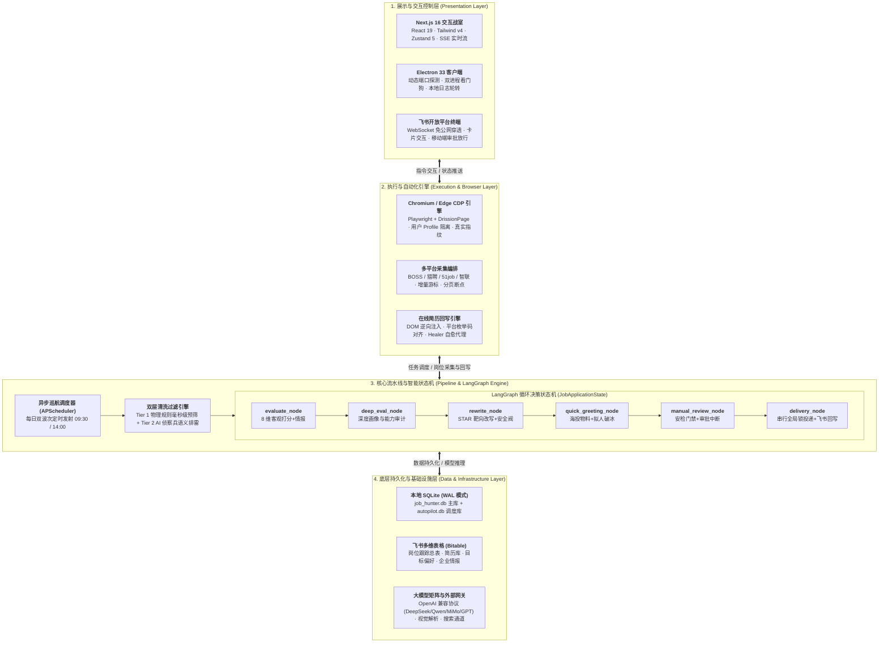
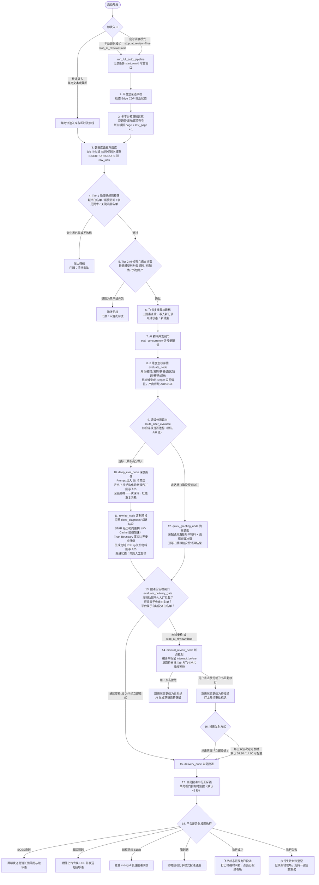
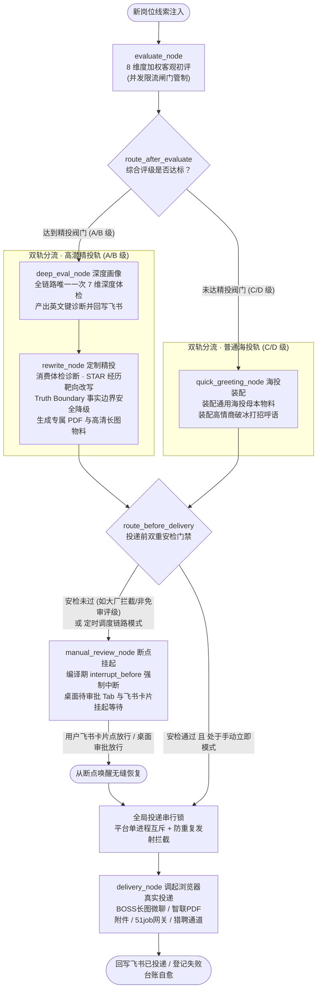
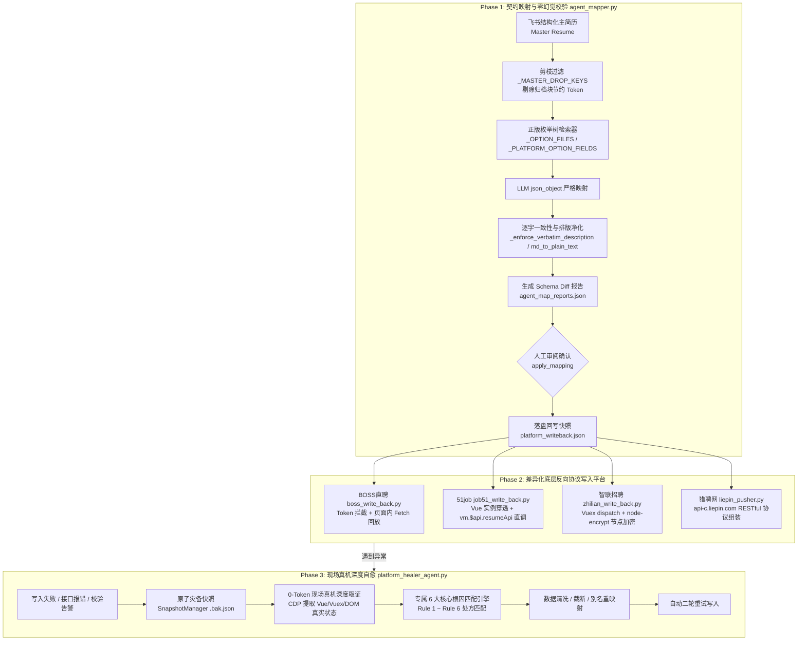

# JobHunter 自动化求职系统 · 底层代码全景功能文档与系统说明书

> **文档性质**：系统底层功能白皮书、代码模块全景拆解、数据流转规约与用户/运维完整操作说明书  
> **全栈底层代码基底**：
> - **前端与交互工程**：Next.js 16 (App Router) + React 19 + TypeScript 5.7 + Tailwind CSS v4 (@tailwindcss/postcss) + Radix UI 全家桶 / shadcn/ui 设计规范 + Zustand 5 全局状态树 + Vditor 4 (双向绑定 Markdown 富文本编辑器) + Recharts 2 (全景大盘与漏斗可视化) + React Resizable Panels (四分区分屏作战室) + SSE (Server-Sent Events) 打字机实时流
> - **后端核心与异步内核**：FastAPI (>=0.114.2) + Pydantic v2 (严格数据模型规约与字段校验) + Pydantic-Settings + Starlette / sse-starlette + aiofiles + Uvicorn + Python 3.10+ 原生高性能异步生态
> - **AI 决策流水线与智能体**：LangGraph (>=1.2.7 循环状态机图) + LangChain + LangChain-OpenAI + LangGraph-checkpoint-sqlite (持久化断点恢复) + 多模型矩阵网关 (DeepSeek-V3/R1、Qwen 系列、小米 MiMo v2.5 / v2.5 Pro、GPT-4o 等) + 靶向经历 STAR 重构 + 事实边界安全阀 (Truth Boundary) + KV Cache / Prompt Cache 前缀加速
> - **自动化巡航与反爬逆向**：Chrome DevTools Protocol (CDP 会话托管) + DrissionPage (>=4.1.1.4) + Playwright (>=1.60.0) + playwright-stealth (>=2.0) + `engine_guard` 跨进程安全守卫 (端口排他锁 + Profile 身份校验) + API 流量包底层监听 (BOSS zpData / 猎聘 pc-search-job 降维打击) + 0ms 内存秒级指纹判重库
> - **数据持久化与基础设施**：SQLite 3 (WAL 预写日志高并发模式) + aiosqlite + SQLModel + Alembic + Redis 8 (高性能可选缓存) + MarkItDown (解析 docx/pdf → Markdown)
> - **桌面壳体与 ChatOps 跨端协同**：Electron 33 + electron-builder 26 (双进程生命周期编排 · 动态端口抢占探测 · 心跳看门狗与遥测 · 本地日志轮转 · DMG/NSIS 原生跨平台打包) + 飞书开放平台 (Lark-OAPI SDK >=1.7.0 · 飞书多维表格 Bitable 双向实时同步 · WebSocket 长连接免公网穿透 ChatOps 指挥中心)

---

## 一、 系统定位与整体设计理念

### 1.1 业务背景与解决的核心痛点
在当代高烈度求职市场中，“海投一份通用简历”的初筛通过率往往不足 3%。求职者每天面临：
1. **多平台频繁切换**：在 BOSS直聘、猎聘、前程无忧（51job）、智联招聘等平台反复搜索筛选，耗费大量体力；
2. **信息噪音与外包诈骗**：大量隐性外包、挂羊头卖狗肉的虚假招聘、以招聘之名行培训/外包之实的黑产岗位充斥列表；
3. **针对性弱**：无法针对每一个具体岗位的技术栈深度定制经历与量化成果，易被 ATS 初筛系统直接过滤；
4. **过程资产不可追踪**：投递历史杂乱、无数据漏斗洞察、缺乏面试复盘体系。

### 1.2 架构哲学：非简单点击器，而是端到端 AI 决策系统
**JobHunter** 不是传统的按键精灵或暴力抓取脚本，它是一套**基于 LangGraph 状态机驱动的端到端自动化求职作战系统**：
- **真实浏览器托管（Anti-Detection）**：基于真实 Edge 浏览器的 CDP 协议与独立用户配置目录（User Data Profile），复用人工登录态，彻底规避反爬与滑块风控；
- **分级过滤体系**：物理级毫秒硬筛选（Tier 1）+ AI 侦察兵排雷（Tier 2），实测可将约 80% 的无谓 LLM 消耗拦截在调用前；
- **双轨自适应物料装配**：A/B 级深度精投（内联体检 + STAR 定制重写 + 独立 PDF/长图物料生成）与 C/D/F 级海投轨（通用话术 + 标准母本物料）动态分流；
- **人机协同安全阀门（Human-in-the-Loop）**：关键节点（如海投超千人大厂、未放行等级）强制触发断点，需用户在桌面端或移动端飞书点击放行，彻底消除误投风险；
- **跨端资产闭环**：以飞书多维表格为云端中枢，实现多端实时双向同步与免公网穿透 ChatOps。

---

## 二、 系统总架构与底层技术栈

JobHunter 采用分层解耦的现代化企业级全栈架构，自顶向下划分为**展示与交互控制层、执行与自动化引擎层、核心流水线与智能状态机层、以及底层持久化与基础设施层**四大核心层级，保障高吞吐自动化与强风控防御：



<details>
<summary><b>查看纯文本 ASCII 拓扑结构树（点击展开）</b></summary>

```
┌─────────────────────────────────────────────────────────────────────────────────────────────┐
│                                   JobHunter 统一技术架构全景                                 │
└─────────────────────────────────────────────────────────────────────────────────────────────┘

  【展示与交互控制层 (Presentation Layer)】
     ├── Next.js 16 (App Router, Tailwind CSS v4, shadcn/ui, Zustand, SSE 实时流)
     ├── Electron 桌面客户端壳体 (跨平台动态端口探测 · 双进程看门狗 · 本地日志轮转)
     └── 飞书开放平台终端 (WebSocket 长连接免公网穿透 · 卡片交互 · 移动端审批放行)

  【执行与自动化引擎 (Execution & Browser Layer)】
     ├── Chromium / Edge CDP 引擎 (Playwright + DrissionPage · 持久化用户 Profile · 真实指纹)
     ├── 多平台自动化爬虫编排 (BOSS / 猎聘 / 51job / 智联 · 增量游标 · 分页状态断点)
     └── 四大平台在线简历回写引擎 (DOM 逆向注入 · 平台枚举代码对齐 · Healer 自愈代理)

  【核心流水线与智能状态机 (Pipeline & LangGraph State Machine)】
     ├── 异步巡航调度器 (APScheduler · 每日双波次定时发射，默认 09:30 / 14:00 可配置)
     ├── 数据清洗引擎 (Tier 1 物理规则毫秒级预筛 + Tier 2 AI 侦察兵 LLM 语义排雷)
     └── LangGraph 决策图状态机 (JobApplicationState 流转):
          ├── [evaluate_node] 8 维客观打分 + 外部企业情报检索 (博查 / Serper / Tavily)，强制 eval_only
          ├── [deep_eval_node] 深度画像与能力审计（高分轨唯一一次深评，产出英文键诊断）
          ├── [rewrite_node] 消费深评诊断做靶向经历重构 + Truth Boundary 安全阀 + PDF/长图物料渲染
          ├── [quick_greeting_node] 海投通用物料挂载 + 拟人打招呼语匹配
          ├── [manual_review_node] 投递安检门禁 + 老板审批中断断点 (Interrupt Before)
          └── [delivery_node] 串行全局锁保护投递 + 平台差异化协议投递 + 飞书终态回写

  【底层持久化与基础设施层 (Data & Infrastructure Layer)】
     ├── SQLite (WAL 模式): 
     │    ├── job_hunter.db (岗位主库 raw_jobs、目标、偏好、Token 消耗审计明细)
     │    └── autopilot.db (自动化调度状态、分流白名单、任务日志、断点快照)
     ├── 飞书多维表格 (Bitable): 岗位跟踪总表、简历库、求职偏好、企业情报
     └── 大模型矩阵与搜索网关 (LLM / Search Gateway):
          ├── OpenAI 兼容协议 (DeepSeek, Qwen, MiMo, GPT 等)
          ├── 视觉多模态能力 (截图/JD 招聘长图解析提取)
          └── 外部搜索引擎 (博查国内直连主引擎 + Serper / Tavily 境外备用)
```
</details>

---

## 三、 核心数据流转全景（一个岗位的一生）

从网络巡航采集到最终投递成功，每个岗位经历以下完整的生命周期状态机。为了确保在所有阅读环境（包括 GitHub、VS Code 原生预览、飞书云文档以及纯文本终端）均能获得最佳阅读体验，本章节提供**双模态可视化展示**：标准 Mermaid 流程图与全景 ASCII 结构拓扑图，并辅以全生命周期状态机速查表：



<details>
<summary><b>查看跨平台全景 ASCII 结构流向图（点击展开）</b></summary>

```
[触发入口] ───┬──► 定时调度波次 (stop_at_review=True) ──┐
              ├──► 手动即刻发射 (stop_at_review=False) ──┼──► [增量窗口捕获] MAX(rowid) -> start_rowid
              └──► 单岗极速录入 (文本/长图/JD) ──────────┘           │
                                                                   ▼
┌─────────────────────────────────────────────────────────────────────────────────────────────────┐
│ 1. 巡航采集阶段 (Scraper)                                                                      │
│    ├── Edge CDP 探活预检 (BOSS:19222, 猎聘:9226, 51job:9227, 智联:9250, 小红书:9224)              │
│    ├── 公平轮巡调度器 (按 last_run 轮换条件，均分平台总预算，记录 scrape_sessions 台账)         │
│    └── 底层 API 流量包拦截 (BOSS zpData 明文薪资 / 猎聘 pc-search-job / 智联 0ms 内存判重)     │
└────────────────────────────────┬────────────────────────────────────────────────────────────────┘
                                 ▼
┌─────────────────────────────────────────────────────────────────────────────────────────────────┐
│ 2. 智能清洗与建档阶段 (Processor & Feishu Sync)                                                 │
│    ├── SQLite 物理指纹去重 (job_link 或 公司+岗位+城市 INSERT OR IGNORE)                         │
│    ├── Tier 1 物理规则毫秒预筛 (城市白名单、薪资区间解析、学历年限底线、一票否决黑名单)        │
│    ├── Tier 2 AI 侦察兵排雷 (小模型甄别假招聘、挂羊头卖狗肉、纯电话销售、隐性外包陷阱)          │
│    └── 飞书多维表格建档 (三要素云端查重，写入新记录，初始门牌状态 =「新线索」)                   │
└────────────────────────────────┬────────────────────────────────────────────────────────────────┘
                                 ▼
┌─────────────────────────────────────────────────────────────────────────────────────────────────┐
│ 3. AI 决策与靶向物料流水线 (LangGraph Workflow)                                                │
│    ├── [evaluate_node] 8 维度加权初评 (角色/技能/资历/薪资/面试/阶段/赛道/成长) + 外部商业情报   │
│    │                                                                                            │
│    ├──► [高分精投轨 (A/B级)] ──► [deep_eval_node] 深度画像与诊断 ──► [rewrite_node] STAR靶向改写│
│    │                                                             (Truth Boundary 安全阀 + PDF) │
│    │                                                                                            │
│    └──► [海投快速轨 (C/D/F级)] ──────────────────────────────────► [quick_greeting_node] 母本装配│
└────────────────────────────────┬────────────────────────────────────────────────────────────────┘
                                 ▼
┌─────────────────────────────────────────────────────────────────────────────────────────────────┐
│ 4. 投递前安检门禁与老板审批 (Safety Gate & Human-in-the-Loop)                                   │
│    ├── 安检判定：海投轨公司规模 ≥ 1000 人强制拦截、免审评级白名单校验、平台自动投递授权校验     │
│    ├── [manual_review_node] 强制中断断点 (interrupt_before)                                    │
│    │    ├── 桌面客户端「待老板审批」Tab 呈现完整 AI 诊断对比与物料预览                          │
│    │    └── 移动端飞书推送富交互卡片 (支持一键「放行审批」或「拒绝归档」)                      │
│    └── 用户放行指令 (界面放行或飞书回复放行) ──► 状态流转为「待投递」                          │
└────────────────────────────────┬────────────────────────────────────────────────────────────────┘
                                 ▼
┌─────────────────────────────────────────────────────────────────────────────────────────────────┐
│ 5. 差异化自动化投递与交付 (Delivery Engine)                                                     │
│    ├── 全局串行互斥锁 (_delivery_serial_lock，单岗 45s 超时看门狗保护)                           │
│    ├── BOSS直聘：微聊通道发送定制长图简历 + 靶向高情商破冰语                                   │
│    ├── 智联招聘：附件中心上传专属排版 PDF + 发送求职问候语                                     │
│    ├── 51job 前程无忧：挂载平台认证 cvLogId 极速通道投递                                        │
│    ├── 猎聘网：猎聘自动化投递流与附件简历装配                                                  │
│    └── 终态回写：飞书多维表格点亮「已投递」看板，记录毫秒级时间戳与执行台账                     │
└─────────────────────────────────────────────────────────────────────────────────────────────────┘
```
</details>

<details>
<summary><b>查看 18 步全生命周期流转状态机速查表（点击展开）</b></summary>

> **术语约定**：表中【门牌】指飞书多维表格（Bitable）中的「跟进状态」字段。

| 步骤编号 | 步骤名称 | 核心执行代码 / 节点 | 关键输入与前置检查 | 产出成果与飞书门牌状态 | 容错与防御机制 |
| :--- | :--- | :--- | :--- | :--- | :--- |
| **[入口]** | **流水线启动** | `run_full_auto_pipeline` | 定时调度（两波次）或手动即刻模式启动 | 生成全局批次 `pipeline_task_id`，捕获 `start_rowid` | 任务互斥锁防并发重入，记录增量窗口基准 |
| **01** | **平台登录态预检** | `preflight.ensure_platforms_ready` | 检查各平台固定端口 Edge CDP 探活状态 | 产出平台健康矩阵，确认 Profile 会话可用 | 识别僵尸进程与无主档案锁，超时优雅告警 |
| **02** | **多平台预算制巡航** | `scrape_runner._run_platform_condition_worker` | 搜索条件矩阵 `(keyword, city, salary)` | 截获各平台原始岗位数据包 | 基于 `last_run` 升序公平轮巡，均分平台总预算 |
| **03** | **数据库去重与落库** | `save_to_raw_db` / `raw_jobs` | 计算 URL 指纹与实体三元组复合键 | 本地 SQLite 落库（`INSERT OR IGNORE`） | WAL 高并发写入模式，杜绝锁库 |
| **04** | **Tier 1 物理硬规则预筛** | `job_processor.step1_rule_filter` | 城市白名单、薪资区间、学历底线、一票否决黑名单 | 淘汰岗落入门牌 **「清洗淘汰」** | 毫秒级规则短路，实测拦截约 80% 的无谓 LLM 消耗 |
| **05** | **Tier 2 AI 侦察兵语义排雷** | `step2_sync_feishu` (`_run_tier2_ai_scout`) | JD 文本投递至低成本轻量模型 | 违规岗落入门牌 **「ai清洗淘汰」** | 深度识别隐性劳务派遣、挂羊头卖狗肉与转培训骗局 |
| **06** | **飞书多维表格建档** | `feishu_client.create_record` | 清洗合格的原始岗位数据 | 飞书多维表格新增行，门牌 **「新线索」** | 云端三要素（公司+岗位+城市）严格查重 |
| **07** | **AI 初评并发闸门** | `workflow.evaluate_node` | 消费 `eval_concurrency` 异步信号量配额 | 平滑控制初评并发吞吐 | 基于 `asyncio.Semaphore` 限制并发，防止触发 LLM 限流 |
| **08** | **8 维度加权评估** | `ai_evaluator.evaluate_job` | 岗位完整 JD + 目标简历 + 外部商业情报 | 产出 8 维雷达客观评分及评级 **A/B/C/D/F** | 维度权重动态平衡，客观中性评分底线保障 |
| **09** | **评级分流路由** | `workflow.route_after_evaluate` | 初评综合评级与设定阈值（默认 A/B 级） | 达标进入精投轨，未达标进入海投轨 | 阈值动态可配置，支持全精投或全海投模式 |
| **10** | **深度画像与能力审计** | `workflow.deep_eval_node` | 仅高分精投轨触发：注入完整 JD 与基础简历 | 产出 7 大模块英文键诊断报告并回写飞书 | 初评结果作为接口参数保留、当前未进入 Prompt；全链路唯一一次深评 |
| **11** | **靶向定制精投改写** | `workflow.rewrite_node` | 消费深评诊断结论，执行 STAR 经历靶向改写 | 生成定制 PDF 与长图物料，门牌 **「简历人工复核」** | **Truth Boundary** 事实边界安全降级，严禁虚构经历 |
| **12** | **海投通用物料装配** | `workflow.quick_greeting_node` | 海投快速轨触发：装配通用母本简历物料 | 装配高情商破冰问候语与通用附件 | 秒级装配母本物料，平滑推进海投流 |
| **13** | **投递前安检闸门** | `workflow.evaluate_delivery_gate` | 校验千人大厂规模门槛、免审白名单、平台授权及 `stop_at_review` | 确定岗位流向断点或立即投递 | **双轨分流**：未过安检或 `stop_at_review=True`（定时调度模式）分流至 14 断点；过安检且 `stop_at_review=False`（手动即刻模式）直通 15 |
| **14** | **老板审批强制中断断点** | `workflow.manual_review_node` | 未过安检 或 定时调度模式（`stop_at_review=True`） | 编译期中断（`interrupt_before`），桌面待审批 Tab 与飞书卡片挂起 | 完整保留 AI 草稿供人工二次润色与审查；用户放行（界面放行或飞书回复放行）后门牌转为「待投递」 |
| **15** | **自动投递执行** | `workflow.delivery_node` | 手动即刻直通 或 用户完成放行审批 | 调起底层投递引擎交付物料 | 串行排他投递，单岗 45 秒看门狗守护 |
| **16** | **投递发射方式调度** | `DISPATCH` 调度器 / `delivery_tasks` | 用户点击界面「立即投递」或每日双波次定时到达 | 驱动队列中的待投递岗位发射 | 每日双波次（默认海投 09:30 / 精投 14:00，均可在投递配置中自定义）批量发射，模拟真实人类求职作息 |
| **17** | **全局投递串行互斥锁** | `_delivery_serial_lock` | 投递执行前抢占全局锁 | 保证单一浏览器会话同时仅服务一个岗位投递 | 独占投递通道，杜绝多岗位并发操作撕裂浏览器 DOM |
| **18** | **平台差异化协议执行** | `delivery_engine` 驱动器 | 差异化平台通道（BOSS / 智联 / 51job / 猎聘） | 完成物料上传、招呼语发送与最终投递动作 | 各平台专属微聊通道、简历附件上传与原生接口对接 |
| **[终态]** | **终态确认与台账登记** | `delivery_engine` + 飞书 SDK | 底层浏览器执行回执与确认状态 | 飞书跟进门牌点亮 **「已投递」** 并登记时间 | 执行失败自动留存错误快照与排查日志，支持一键自愈重试 |

</details>

---

## 四、 15 大底层功能模块深度代码剖析

### 4.1 多平台自动化巡航采集引擎 (Scraper Engine)

多平台自动化巡航采集引擎是 JobHunter 系统的“数字原料供给中枢”。它彻底摒弃了传统爬虫易被封禁的低效纯 HTTP 模拟请求，采用**以真实指纹为基石的浏览器会话托管架构（CDP Session Hosting）**，打通了主流招聘平台（BOSS直聘、猎聘、智联招聘、前程无忧 51job）以及新兴求职阵地（小红书）的自动化线索捕获链路。

#### 1. 采集矩阵全景速查表 (Matrix Overview)

系统为各大平台建立了专属的物理隔离环境与多维度解析策略，核心业务能力全貌如下：

| 渠道矩阵 | 专属独立会话 | 业务痛点与平台挑战 | JobHunter 核心业务价值 | 用户体验与风控保障 |
| :--- | :--- | :--- | :--- | :--- |
| **BOSS直聘** | 独立数据沙箱 | 动态字体混淆导致薪资乱码、频繁弹窗干扰 | 自动还原明文真实薪资；就地提取大厦与门牌号算准通勤 | 真实硬件指纹持久化、人机动力学平滑延时 |
| **猎聘网** | 独立数据沙箱 | 接口残留已下架失效岗位、年薪月薪折算复杂 | 视觉卡片双重核验自动剔除僵尸岗；月薪年薪智能统一换算 | 动态阻尼视线滚动仿真、会话凭据无感自愈 |
| **智联招聘** | 独立数据沙箱 | 页面复杂易卡死、海量岗位重复扫视耗时 | 毫秒级内存判重永远不看重样岗位；筛选条件自愈锁定期望薪资 | 现场异常全量留存快照、真实鼠标物理事件链 |
| **前程无忧** | 独立数据沙箱 | 复合多选参数维度深、页面结构沉重繁杂 | 多目标城市与薪资档位一次拉满；完整获取无删减真实职责 JD | 轻量索引快扫与详情深度获取分工协作 |
| **小红书** | 独立数据沙箱 | 非结构化排版、业务长图与内推帖混排 | 深度挖掘企业业务主管直聘贴与一手内推；避开 HR 简历海选 | 专属内容排重、图文多模态深度解析 |

#### 2. 安全与隐私保障：专注求职，绝不打扰你的日常工作

* **与你的个人浏览器彻底隔离**：JobHunter 运行在独立的后台沙箱中，你的个人日常浏览器（无论是日常工作查资料、看视频还是聊微信）完全不受任何影响，互不串号、互不干扰。
* **个人隐私与账号绝对安全**：系统具备跨进程环境守护机制，严格限制仅在专属沙箱中执行任务，绝不触碰你的个人浏览历史与私人数据，守卫未通过前严禁发出任何网络请求。
* **告别天天重复扫码的烦恼**：真实持久化保留你在各招聘平台的登录状态，一次扫码长效有效，每天自动启动巡航，不用反复拿手机扫码认证。

#### 3. 智能巡航与极速响应：多方向兼顾，好机会秒级送达

* **多维度搜索条件队列 (Search Condition Queue)**：支持在后台配置由多个「关键词 × 目标城市 × 期望薪资」组合而成的复合搜索队列（如同时监控“产品经理·北京”、“运营专家·上海”、“AI 产品·杭州”），形成立体求职矩阵；
* **雨露均沾的公平调度 (Fair-Share)**：传统脚本往往由排在前面的搜索词占满整日抓取配额，导致队列后面的方向长期得不到执行。系统将每日抓取预算动态均分给队列中的每一个活跃条件，按最久未运行时间轮流交替巡航，绝不会因为前一个词岗位多就把预算全部占满，确保你的每个求职方向都能获得平等的探索机会；
* **边搜边洗，分秒必争**：网络上一旦捕获到一条最新线索，后台流水线立刻开工清洗、排雷并送入 AI 评估，无需等待整批几百个岗位搜完，心仪职位秒级呈现；
* **只看新鲜岗位**：每轮任务自动记录上次巡航的水位线，绝不重复扫视几天前的陈旧岗位，省电省资源。

#### 4. 贴心管家与防封自愈：人在地铁上，手机飞书也能掌控全局

系统构筑了严密的人机协同闭环，兼顾高效率与账号安全：

* **完全模拟真实人类节奏**：不狂刷、不蛮干，在每次浏览之间模拟真实人类的阅读停顿与视线滑动，严格遵循安全访问频率，保护你的平台账号永不被封禁；
* **遇到滑块乖乖等候**：若遇到安全滑块，系统会就地安全暂停并在终端提示，等你顺手在屏幕上滑过之后，毫秒级自动接力继续执行；
* **手机飞书随身督战，掉线一键扫码自愈**：偶尔登录状态过期时，你的手机飞书会立刻收到一张精美的提醒卡片；你在电脑前扫码登录后，系统自动感知并恢复任务，外出在地铁、在餐厅也能安心挂机；
* **抓取与投递互不干扰**：搜岗与投递拥有各自独立的安全通道，绝不会因为同时操作导致页面冲突或点错按钮。

### 4.2 双层智能清洗与去重排雷引擎 (Job Processor)

在海量岗位线索中，通常夹杂着大量不符合期望的无效岗位、虚假招聘甚至套路黑产。系统设计了“硬规则短路过滤 + AI 语义深度排雷”的双层漏斗机制，毫秒级拦截无价值岗位，确保流入后续大模型决策流水线的数据纯净度达到 99% 以上：

1. **SQLite 层物理指纹去重**：以 `job_link` 作为唯一物理主键，并在落库前自动计算 `(company_name, job_title, city)` 实体三元组复合指纹，执行 `INSERT OR IGNORE`，杜绝多渠道重复采集入库；
2. **Tier 1 物理规则毫秒级预筛**：
   - 城市范围核验（支持多城市白名单模糊与逗号分割匹配）；
   - 薪酬范围解析（毫秒级提取 `15-25K`、`20-40K·16薪` 的区间底线，不达标即刻短路淘汰）；
   - 学历与经验年限底线筛选（大专/本科/硕士对齐，过滤年限不符的岗位）；
   - 关键词一票否决黑名单（毫秒级阻断带有明确字面违规词的岗位）；
3. **Tier 2 AI 侦察兵语义排雷（深度上下文审查）**：
   - **痛点破局：消灭“文字伪装”与“挂羊头卖狗肉”**：
     - 很多不良岗位极擅长文字伪装（如标题叫“技术专家”，正文却写“配合开拓客户并按月度业绩提成”，实质是销售）；
     - 隐性作息陷阱（如写“大小周”、“月休 4 天”、“5 天半工作制”，普通关键词根本无法拦截）；
     - 避免大面积误杀好岗位（如好公司写“需具备外包团队管理经验”，传统爬虫遇“外包”两字一刀切误杀；但实际要防的是“非本公司直接雇佣的人力外包派遣”）。AI 具备段落上下文语义理解，能精准识别真实用工语境。
   - **双轨规则库判定：Must（必须满足） vs Never（绝不容忍红线）**：
     - 用户可在策略面板自由配置判定维度（支持自定义增删改），系统默认内置 5 大排雷准则：
       - **绝不接受单休 (Never)**：深度识别“大小周、单休、每周工作 6 天、月休 4~6 天”等所有工时超标与伪装表述；
       - **绝不接受外包 (Never)**：精准甄别非本公司直接雇佣的“人力外包、劳务派遣、驻场外派”，同时智能放行内部含有“外包管理”字样的优质自研岗位；
       - **绝不接受变相销售 (Never)**：识别 JD 中隐含的“电销、BD、客户拓展、业绩提成”等纯销售性质；
       - **绝不接受非正式用工 (Never)**：识别“实习生、小时工、兼职”，区分“要求有实习经历”与“招募实习生”的真实语义；
       - **转培训与套路贷骗局排雷**：识别“招学徒/助理、入职提供高薪技能培训、考核通过后补缴学费”等招聘黑产。
   - **死因严格溯源：必须附带【JD 原文证据】（白盒化抗误杀）**：
     - 模型在判定某个岗位触发违规红线（如判定为“外包”或“销售”）时，**必须在输出中一字不差地从 JD 中摘抄出那句违规原文**（禁止总结改写）；
     - 系统自动核对摘录真实性，将死因精准标记为例如：`触发 AI 侦察兵排雷: 触发绝不条件 [外包]，JD 原句: “本岗位系第三方人力资源公司签署合同并派驻至银行驻场”`；
     - 用户在飞书或系统大盘的「清洗淘汰」看板中复核时，一眼就能看清违规证据，彻底拒绝黑盒判定与莫须有误杀。
   - **高吞吐并发与 Fail-Preserve 容灾自愈**：
     - 调用低成本高吞吐大模型，采用 5 并发异步流水线极速排雷；
     - 若遭遇网络波动或模型返回格式异常，系统执行 **Fail-Preserve（安全保全）**：该岗位自动保留在「待 AI 初筛」候选池中，等网络恢复后由下一轮无缝重试，绝不盲目判死，也绝不无脑放行。
4. **飞书端三要素查重同步**：通过 `step2_sync_feishu.py` 将清洗合格的岗位推入飞书多维表格，自动生成“新线索”记录，并反写 `feishu_record_id` 到本地 `raw_jobs` 表。

### 4.3 基于 LangGraph 的核心决策状态机流水线 (Automation Workflow)

在传统的招聘自动化工具中，求职流程往往被写成死板的线性脚本（If-Else 循环）：一旦中途遭遇网络抖动或需要人工确认，整个流程要么全盘崩溃丢失进度，要么只能盲目全自动乱投。

JobHunter 原创引入 **LangGraph 有状态图（StateGraph）** 作为核心决策引擎，将一个岗位从清洗入库到最终投递的全生命周期建模为一个严格的、可中断、可自愈的**工业级有限状态机**：



#### 1. 为什么选择 LangGraph？状态机三大核心哲学

1. **有状态图与断点续跑 (State & Checkpointing)**：每个岗位在状态机中都拥有一份独立的全局状态字典，并结合 SQLite 持久化检查点。哪怕流水线中途遭遇电脑关机或网络断开，系统重启后也能精准定位断点位置无缝续跑，绝不重复扣减大模型 Token，也绝不丢弃任何分析产物；
2. **编译期人机断点 (Human-in-the-Loop)**：求职者最担心的莫过于 AI 盲目自作主张。状态机在编译时声明了 `interrupt_before=["manual_review_node"]` 强制挂起机制——对于高价值岗位，AI 改写完成并生成物料后会**在投递前毫秒级暂停**，把成果推送到飞书或桌面看板，完全由求职者审批放行后才调起投递；
3. **动态算力倾斜（双轨制帕累托最优）**：海量岗位不可能全部耗费高昂算力做精雕细琢。系统根据初评结果实施精准分流，把 80% 的深度改写算力集中投入到最具潜力的 20% 高分岗位，其余岗位走轻量海投通道，兼顾求职质量与推进效率。

#### 2. 岗位全景数据载荷拓扑 (JobApplicationState Schema)

在状态机运转过程中，每个岗位都随身携带一份标准化的数据档案。系统将其归纳为四层清晰的数据结构：

| 数据分层 | 核心字段 (`Field`) | 字段类型 | 业务语义与承载价值 |
| :--- | :--- | :--- | :--- |
| **1. 岗位基础信息层** | `platform`, `company_name`, `job_name` | 字符串 | 来源招聘平台、企业全称、岗位标准名称 |
| | `jd_text`, `salary`, `city` | 字符串 | JD 原文纯文本、薪资范围区间、工作城市 |
| | `experience`, `education`, `job_url` | 字符串 | 经验年限要求、学历底线、原始岗位直达链接 |
| **2. 求职者画像与情报层** | `resume_text` | 纯文本 | 当前启用的求职者基准主简历 |
| | `mass_resume_text` | 纯文本 | 针对海投轨优化的通用底料简历 |
| | `preferences_text` | 纯文本 | 用户求职意向偏好与底线红线规则 |
| | `company_intel` | 纯文本 | 博查/Serper 检索出的企业商业情报与舆情 |
| **3. AI 决策与物料产物层** | `ai_score`, `grade` | 浮点数 / 评级 | 8 维度综合加权评分 (0~100) 与 A/B/C/D/F 评级 |
| | `diagnosis_dict`, `deep_diagnosis` | 字典对象 | 8 维初评诊断字典与高分轨 7 大深度画像字典 |
| | `final_markdown`, `greeting` | Markdown / 文本 | 针对本岗位靶向改写的结构化简历与专属破冰打招呼语 |
| **4. 状态机流转与安全控制层** | `status` | 门牌字符串 | 飞书多维表格当前的跟进状态（如待AI初筛、简历人工复核、待投递、已投递等） |
| | `stop_at_review` | 布尔值 | 定时链路挂起断点控制（True 时强制在人工审批前断点挂起） |
| | `pipeline_task_id` | 任务哈希 | 本轮批次流水线的广播任务 ID，驱动前端导轨秒级渲染 |

#### 3. 全生命周期 6 步决策链深度剖析

1. **`evaluate_node`（8 维客观初评与并发限流）**：
   - 受 `eval_concurrency` 信号量管制（默认 5 并发），闸门忙时广播「排队中」，排到后广播「打分中」；
   - 严格锁定 `task_mode="eval_only"`，专注于 8 维匹配度计算与企业背景联网核验，绝不在本节点内联跑改写，杜绝后续重复计算；
2. **`route_after_evaluate`（智能双轨条件路由）**：
   - 动态读取策略配置的精投阀门（默认 A/B 级），同标准判定；
   - 达标进入**精投定制高潜轨**；未达标统一进入**海投轻量极速轨**；
3. **精投高潜轨 (`deep_eval_node` -> `rewrite_node`)**：
   - **全链路唯一一次深评**：`deep_eval_node` 产出 7 维深度画像英文键字典，并将诊断回写飞书；
   - **靶向重构与物料渲染**：`rewrite_node` 消费上述诊断，使用 STAR 原则靶向改写经历，经 Truth Boundary 安全降级后，自动渲染为专属 PDF 简历与微聊高清长图；
4. **海投轻量极速轨 (`quick_greeting_node`)**：
   - 跳过深度改写，秒级装配通用海投母本简历，并填充经过人工审定的高情商破冰打招呼语，杜绝模型现场瞎编；
5. **`route_before_delivery`（发车前双重安检门禁）**：
   - **大厂规模防火墙**：在 C-F 级海投路径上，若识别到公司规模 ≥ 门槛（默认 1000 人），立即拦截并转入人工复核，严防使用通用模板投递大厂造成不良印象；
   - **免审白名单判定**：核验该岗位的平台与评级是否位于用户开启的自动投递白名单中；未授权的岗位一律分流至 `manual_review_node` 挂起；
6. **`delivery_node`（全局投递串行锁与真实交付）**：
   - **单进程物理排它**：持有平台级串行互斥锁，严禁多浏览器实例抢占 DOM 焦点与端口；
   - **防重复发射拦截**：对正在投递中的岗位实行全局 ID 互斥，杜绝手动立即投递、定时波次与自愈重试并发导致的重复微聊打扰；
   - **真实交付与闭环回写**：调起底层浏览器执行发送，成功后飞书门牌更新为「已投递」并记录时间戳；若遇登录失效等异常，自动沉淀至本地执行失败台账等待一键自愈。

### 4.4 AI 8 维度评估与深度画像系统 (AI Evaluator & Scorer)
- **代码路径**：
  - `backend/ai_agents/ai_evaluator.py`
  - `backend/ai_agents/ai_scorer.py`
  - `backend/ai_agents/company_intel.py`
- **8 维度客观评价标准与加权体系**：
  | 维度键名 (`dimension`) | 维度中文名称 | 默认权重 | 核心评估标准 |
  | :--- | :--- | :--- | :--- |
  | `role_match` | 角色匹配 | 1.0 | 角色定位与目标岗位契合度，对口行业背景加分 |
  | `skills_align` | 技能重合 | 1.0 | 技术栈硬性重合度，对照核心工具与语言要求 |
  | `seniority` | 职级资历 | 0.8 | 业务盘子独立负责能力与项目深度，能力溢出打满分 |
  | `compensation` | 薪资契合 | 0.8 | 强制读取薪资区间，与期望薪资匹配度对比 |
  | `interview_prob`| 面试概率 | 0.8 | 综合初筛与技术面通过概率预判 |
  | `company_stage` | 公司阶段 | 0.2 | 中性/奖励逻辑（缺失默认 3 分，禁止盲目打 1-2 分） |
  | `market_fit` | 赛道前景 | 0.5 | 结合网络搜索情报，评估行业生命周期与增长潜力 |
  | `growth` | 成长空间 | 0.5 | 个人技术边界拓展空间与平台赋能深度 |

- **企业情报统一检索（Company Intel）**：
  - 主引擎：**博查 API**（国内直连、注册送 1000 次，4 路高并发多维商业情报分析：融资背景、主营业务、AI 落地、近期负面舆情）；
  - 备用引擎：**Serper API**（Google Search 原生管道，需要境外网络）；
  - 兜底引擎：**Tavily API**（面向大模型的专业检索接口，需要境外网络）。

- **深度画像 7 大结构化诊断报告（Wave 2）**：
  1. `jd_analysis`：岗位本质与潜台词深度剖析；
  2. `dream_picture`：招聘负责人心目中的理想候选人全貌；
  3. `ats_ability_analysis`：核心能力词典（ATS 必备关键词拓扑）；
  4. `line_by_line_audit`：候选人原始经历逐行硬伤审计；
  5. `strong_fit_assessment`：高杠杆突出契合点（改写重点攻坚）；
  6. `risk_red_flags`：致命硬伤与毒点预警（改写严禁踩雷）；
  7. `deep_action_plan`：破局改写行动指南。

### 4.5 KV Cache 与 Prompt Cache 极致降本架构
- **技术突破**：彻底破解 Multi-Agent 流水线高并发时 Token 成本爆炸（量级估算：每天 50 岗无缓存纯冷消耗可达 40 万 Token 以上）与首字延迟（TTFT）过长的工程难题。
- **物理实现原则**：
  1. **静态前缀对齐（Prefix Alignment）**：严格遵循 GPU Radix Tree（基数树）连续匹配规则，将不可变的 System Prompt 与候选人基础简历置于上下文最前端（0~3000 Token 字节级冻结）；
  2. **1-Token 点火预热（Warmup Pulse）**：在批量流水线启动前，以最小开销（1 个 Token 输出）预热大模型节点显存，建立全局缓存基石；
  3. **实际收益（工程实录实测口径）**：
     - 初评阶段 Prompt Cache 命中率实测达 **99%+**（单次命中约 5056 Token）；
     - 改写阶段实测节省 **70%+** Prefill 算力（单次命中约 6144 Token），并发改写耗时从近 130 秒缩短至 90~110 秒；
     - 首字生成延迟（TTFT）从数秒骤降至毫秒级。

### 4.6 靶向简历改写与 Truth Boundary 事实边界安全阀
- **代码路径**：
  - `backend/ai_agents/skill_rewrite.py`
  - `backend/ai_agents/skills/skill_agent_runner.py`
  - `backend/ai_agents/skills/truth_boundary.json`
- **动态 Skill 剧本管理**：
  - 支持官方标准改写剧本（`resume_rewrite.md`）与用户上传的自定义行业特化技能包（支持多轮推演与子图扩展）；
  - 支持将 Wave 2 产出的 7 大体检诊断作为上下文避坑指导内联注入。
- **Truth Boundary 降级安全阀**：
  - 在改写生成完成后，执行严格的正规化扫描，拦截 AI 的虚假放大与浮夸表达：
    - 将“全权负责”、“主导全盘架构”等在缺乏证据时降级为“核心参与”、“负责核心模块”；
    - 针对高危夸大词库自动回退到事实边界，保留真实的量化 STAR 结构（Situation、Task、Action、Result）。

### 4.7 自定义简历 Skill 改写与渐进式 Agent 推演引擎 (Dynamic Resume Skills & Progressive Agent)
- **代码路径**：
  - `backend/ai_agents/skills/skill_agent_runner.py`（Tool-Use 渐进式多轮推演执行器）
  - `backend/ai_agents/skills/skill_loader.py`（动态技能管理器，双根扫描与元数据加载）
  - `backend/ai_agents/skills/skill_contract.py`（产物契约解析、轮次与 Token 消耗静态预估）
  - `backend/ai_agents/skills/skill_upload_policy.py` & `skill_validator.py`（多格式安全沙箱校验与解包策略）
  - `backend/app/api/routes/skills.py` & `skills_upload.py`（动态技能管理与导入 API 路由）
  - `frontend/components/skill-selector/` & `skill-preflight-dialog.tsx`（前端技能选择与起飞前契约校验）
- **核心业务价值与架构革新**：
  - **超越单一硬编码 Prompt**：告别市面上“一段静态提示词包打天下”的脆弱改写模式，JobHunter 原创引入类似 Claude Code / Antigravity 的**标准化智能体技能包（Skill Package）体系**，支持为不同行业、职级（如 Java 后端、算法工程师、产品经理、大模型应用架构师）量身定制独立的 SOP 推演工作流；
  - **双层技能根隔离架构（Dual-Root Isolation）**：
    1. **内置技能根（`SKILLS_DIR`）**：随安装包分发的只读官方技能（如 `resume_rewrite.md`、`greeting_writer.md`），内置官方保护锁，严禁用户误删；
    2. **自定义技能根（`CUSTOM_SKILLS_DIR`）**：收口位于系统 `userData/skills` 用户数据目录，确保系统版本升级、覆盖重装时用户的特化技能资产 100% 持久保留。
- **多格式极速安全导入与沙箱校验机制**：
  - **4 大安全导入形态**：支持单 Markdown 剧本（`.md`）、打包技能压缩包（`.zip`）、本地文件夹拖拽上传、以及 GitHub 仓库地址一键克隆安装；
  - **全套严格的安全策略守卫（`skill_upload_policy.py`）**：
    - **Zip Slip 路径穿越防御**：解压时严格校验相对路径与规范化前缀，彻底阻断包含 `../` 的越权覆盖攻击；
    - **可执行脚本黑名单**：严格阻断任何包含可执行文件（`.py`, `.sh`, `.exe`, `.bat`, `.dll` 等）的可疑压缩包，仅允许纯 Markdown 与配置落盘；
    - **配额安全阀**：限制文件总数 $\le 50$、单包解压体积 $\le 10\text{MB}$，防范 Zip 炸弹资源耗尽；
    - **目录规范性校验（`skill_validator.py`）**：强制校验根目录必须包含合规的 `SKILL.md`（带 YAML Frontmatter：name, version, description）及完整的 `references/` 规范目录。
- **Tool-Use 渐进式智能体推演循环（Progressive Agent Runner）**：
  - **初始轻量注入**：初始提示词仅向模型注入精简的 `SKILL.md` 顶层目录与阶段 SOP，避免全量文档直接塞入导致上下文膨胀与注意力涣散；
  - **赋予 Agent 3 大专属工具（OpenAI Function Calling）**：
    1. `list_references`：动态发现当前技能包中包含的所有行业规范、避坑红线与标准词典；
    2. `read_reference`：模型按需精确查阅 `references/*.md`（**零删减、原汁原味按需检索**，彻底攻克长上下文丢失细节难题）；
    3. `save_step_artifact`：阶段性作战产物实时落盘与持久化归档（如 `01_jd_analysis.md` 岗位解构、`02_truth_boundary.md` 事实边界核对、直至 `06_targeted_resume.md` 定制简历等 11 个阶段性推演产物）。
- **严格的定稿契约与自愈续写机制**：
  - **严密定稿判据**：改写产物仅严格认可带闭合 `<FINAL_RESUME>` 标签、精确文件名为 `06_targeted_resume.md`、或显式标记 `is_final_resume=True` 的正文，杜绝中间分析过程草稿被错误当成终版简历写回飞书；
  - **长度截断整轮作废与自愈引导**：当遇到推理模型输出截断（`finish_reason=length`）时，系统自动丢弃残缺的工具调用，下发 `_TRUNCATION_CONTINUE_PROMPT` 引导模型拆分为单份产物重新落盘，连续截断熔断保护；
  - **纯过程闲聊拦截（Narration Trap）**：针对大模型“只讲过程性说明却未调用工具落盘”的行为，自动注入 `_NARRATION_CONTINUE_PROMPT` 强推 SOP 履约；
  - **部分成功（Partial Success）对账机制**：只要核心 06 简历定稿有效，即使辅助分析因上下文中断也标记为部分有效（N/11），通过对账闸门原子落盘。
- **起飞前契约扫描（Pre-flight Contract）与实时推演推流**：
  - **起飞前白盒预估**：在用户发起改写前，`skill_contract.py` 静态解构目标技能包的 SOP 规划，预估预计产物数、交互轮次（Turns）与 Token 预算，在前端弹出 `SkillPreflightDialog` 获得用户授权；
  - **推演事件 SSE 全程透明广播**：多轮推演时的 `agent_start`、`step_start`、`tool_call`（查阅参考资料）、`artifact_saved`（产物落盘）实时推送到前端作战推演看板，全过程白盒可见。

### 4.8 四大平台在线简历自动回写与自愈修复引擎 (Resume Backwrite)

- **核心代码路径**：
  - **核心映射与契约引擎**：`backend/resume_editor/agent_mapper.py`（约 4800 行严密映射核心）
  - **BOSS直聘逆向写入**：`backend/resume_editor/platforms/boss_write_back.py`（约 52KB，Token 劫持与 Fetch 回放）
  - **51job 逆向写入**：`backend/resume_editor/platforms/job51_write_back.py`（约 68KB，Vue 实例原生 API 穿透）
  - **智联招聘逆向写入**：`backend/resume_editor/platforms/zhilian_write_back.py`（约 92KB，Vuex Action 节点加密回写）
  - **猎聘网逆向写入**：`backend/resume_editor/platforms/liepin_pusher.py`（约 50KB，RESTful 载荷推送）
  - **四大平台深度自愈 Agent**：
    - `backend/resume_editor/platforms/boss_healer_agent.py`
    - `backend/resume_editor/platforms/job51_healer_agent.py`
    - `backend/resume_editor/platforms/zhilian_healer_agent.py`
    - `backend/resume_editor/platforms/liepin_healer_agent.py`

#### 4.8.1 三阶全生命周期闭环架构
在线简历自动回写引擎并非简单的“复制粘贴自动化”，而是一套兼顾**跨平台 Schema 异构适配、官方防爬与数据安全防御、底层逆向协议通讯、以及故障自动愈合**的企业级同步管线：



---

#### 4.8.2 Phase 1: 语义对齐与零幻觉契约映射引擎 (`agent_mapper.py`)
`agent_mapper.py` 拥有超过 4800 行底层严密代码，是保证数据准确性与合规性的核心大脑：

1. **结构化解构与归档剪枝 (`_MASTER_DROP_KEYS`)**：
   - 飞书主简历从多维表格拉取后，自动进行结构化展开；
   - 强制剥离 `archivedProjects`、`archivedWorkExperience` 与 `moduleOrder`，杜绝已淘汰的历史沉淀经历被误写入线上，同时大幅节省大模型上下文 Token。

2. **多级官方字典树遍历与扁平化对齐 (`_OPTION_FILES` / 提取器体系)**：
   - 系统绝不允许大模型自由“凭空捏造”代码。内置各平台官方只读字典库（如 `boss_city_full.json`, `boss_industry_options.json`, `liepin_job_categories.json` 等）；
   - 递归树提取算法：`_walk_tree()` 递归解构多级 `subLevelModelList` 节点，构建 `build_name_code_map()` 映射表；
   - 复杂字段专用提取器：
     - `_extractor_cities_flat`：合并各大平台热门城市与全部省市列表，生成全局扁平城市库；
     - `_extractor_degrees_combo`：针对 BOSS 直聘要求存为 `“学历 / 学制”` 的格式，自动遍历生成（如 `大专 / 全日制`、`本科 / 全日制`、`硕士 / 非全日制`）；
     - `_extractor_job_types`：严格约束全职 (`fulltime`) 与兼职 (`parttime`)；
     - 遇到主简历存在但目标平台无法精准命中合法 Code 的枚举项，一律主动打入 `unfilled` 暂存区并生成 Warning，**坚决杜绝非法 Code 导致官网报错**。

3. **零捏造与逐字一致性兜底保障 (`_enforce_verbatim_description`)**：
   - **排版净化 (`md_to_plain_text`)**：由于各大招聘平台输入框不支持 Markdown 原始语法（会导致 HR 看到充满 `#`、`**` 的乱码），系统在写入前自动剔除 Markdown 标题、加粗、代码块与链接，转换为优雅整洁的换行纯文本；
   - **经历描述逐字照抄 (Verbatim Guarantee)**：
     - 如果大模型擅自精简、篡改或润色了工作经历与项目描述，`_enforce_verbatim_description` 会通过项目名、公司名、起止时间双重锚定原文；只要发现内容不一致，立即使用主简历原文**强制覆盖**大模型输出，并在报告中追加警告记录；
     - 主简历无对应描述时，清空大模型可能脑补的虚假内容；
   - **平台异构模块智能分流 (`_split_project_sections`)**：
     - **猎聘专属三段分流**：由于猎聘将项目经历拆分为“项目描述”、“项目职责”、“项目业绩”三个互斥输入框，分流算法将主简历文本自动拆解分配，确保三者互不包含、不重复；
     - **BOSS直聘专属两段分流**：将主简历内容拆分为“项目描述（背景与核心职责）”与“项目业绩（成果产出）”。

4. **置信度评级与持久化审阅流 (`agent_map_reports.json`)**：
   - 每一个输出字段均携带 `confidence`（`high` / `medium` / `low`）、`source`（来源字段）与 `note`（推导说明）；
   - 映射结果落盘至 `agent_map_reports.json`，供前端进行全量 Visual Diff 差量对比，用户审阅满意后触发 `apply_mapping`，生成冻结态快照 `{platform}_writeback.json`。

---

#### 4.8.3 Phase 2: 四大平台差异化底层反向协议与免 UI 模拟写入

系统摒弃了极易受前端 CSS 类名变动、弹窗打断、输入框失焦导致失败的传统“逐个点击 DOM 输入框”方案，针对四大平台全面研发了**免 UI 交互的逆向协议回放技术**：

##### 1. BOSS 直聘：Token 劫持与页面内 Fetch 回放 (`boss_write_back.py`)
- **握手与 Token 劫持 (`load_preview_and_tokens`)**：
  - 通过 CDP 连接本地已登录的 Edge/Chrome 调试端口（`19222`）；
  - 启动网络监听器 `page.listen.start("geek/preview/data.json")` 并刷新简历主页；
  - 拦截官方接口响应，提取当前官网全量结构数据 `zpData`；同时从 Request Headers 中窃取本次会话合法的动态鉴权凭证：`zp_token` 与 `token`（重试机制保障高抗丢包率）。
- **页面内上下文 Fetch 回放 (`post_form` / `fetch_json_api`)**：
  - 直接在当前页面 DOM 环境注入 JS：`fetch(url, { headers: { zp_token, token, 'X-Requested-With': 'XMLHttpRequest' }, body: formData })`；
  - 完美继承宿主浏览器的 Cookie、User-Agent、TLS 指纹与跨域安全凭据，实现 100% 原生可信请求。
- **全模块接口覆盖矩阵**：
  - 个人优势：`POST /userdesc/save.json`
  - 工作经历：`POST /workexp/save.json`（保留官网职位码与 id，增量更新）
  - 项目经历：`POST /projectexp/save.json`（按 URL/起止日期匹配官网已有 id）
  - 资格证书：`POST /certification/save.json`（本地为准全量覆盖，官网多余证书自动同步删除）
  - 驻外经历：`POST /overseastraitoptions/collectinformation/save.json`
  - 求职期望：`POST /expect/save.json`（全量覆盖：匹配则更新、本地未匹配则新增、官网多余条目调 `delete.json` 删除）
  - 教育经历：`POST /eduexp/save.json`
  - 基本信息：`POST /baseinfo/save.json`
- **`HARD_SKIP` 核心安全红线拦截**：
  - `name`：官网通常为脱敏昵称（如“张女士”），**严禁改写**，否则直接触发平台人工实名审核甚至封号；
  - `phone` / `email` / `wechat`：本地抓取值为脱敏态（如 `138****0000`），回写会永久损毁线上真实联系方式，**强制排除**；
  - `experience_years`：平台根据教育经历与工作经历自动计算的衍生只读字段，无保存端点。

##### 2. 51job 前程无忧：Vue 实例穿透与原生 API 直调 (`job51_write_back.py`)
- **Nuxt/Vue 组件树穿透**：
  - 页面基于 Nuxt.js/Vue 架构，系统通过执行 JS：`var nuxt = document.querySelector('#__nuxt') || document.querySelector('#app')` 获取根 Vue 实例 `vm`；
  - 深度递归探测算法 `findByName(vm, 'PCResume', 0)`，秒级穿透 10 层组件树，直接定位核心简历组件 `PCResume`，提取官网内部真实的 `resumeId`。
- **原生直调 `vm.$api.resumeApi`**：
  - 直接调用页面已挂载的原生 API 对象：`vm.$api.resumeApi`，完全绕过底层 `cupid.51job.com` 的请求加密与动态验签逻辑；
  - **精细化端点调度**：
    - 自我介绍：`editSelfIntroduction`
    - 求职意向：`editIntention` / `addIntention` / `delIntention`
    - 工作经历：`editWorkExp` / `addWorkExpList` / `delWorkExp`
    - 项目经历：`getProjectEdit` / `getProjectAdd` / `getProjectDel`
    - 教育经历：`editEducation` / `addEducation` / `delEducation`
    - 专业技能：`getSkillItEdit` / `getSkillItAdd` / `getSkillItDel`
    - 语言能力：`languageEdit` / `languageAdd` / `languageDel`
    - 资格证书：`getCertificateEdit` / `getCertificateDel`
- **求职状态合法性强校验 (`_resolve_current_situation`)**：
  - 官网求职状态枚举在实机标定中仅允许 `1`（离职-周内到岗）、`2`（在职-月内到岗）、`3`（在职-观望机会）以及 4/5/6（学生态）；
  - **根因缺陷修复**：历史大模型常映射出 `0`；由于 51job 后端接收到 `0` 时虽返回成功 HTTP 200，但内部因枚举非法静默忽略修改，导致下一次复核时求职状态永远不一致产生死循环。系统内置合法性门禁，非法值强制自动回退官网原值并预警。
- **List Diff 智能增删改调度**：
  - 自动对比本地快照与线上条目：匹配官方 `id` 执行 `edit`；本地新增项剥离只读字段（`_ADD_STRIP`: `id`, `complete`, `diagnosis` 等）执行 `add`；官网冗余条目自动执行 `del`。

##### 3. 智联招聘：Vuex Store 穿透与节点加密回写 (`zhilian_write_back.py`)
- **Vuex Store 深度穿透**：
  - 深入 `document.querySelector('#root').__vue__.$store`；
  - 调用全局 Store Action：`store.dispatch('resume/updateResumeAction', payload)`；
  - 底层直接唤醒智联官方前端加密模块 `fe-api.zhaopin.com/c/i/resume/node-encrypt`，完成数据打包与对称密钥加密上传。
- **双轨业务键与索引漂移自愈定位**：
  - 智联各经历节点依赖 `path` 路径寻址（如 `WorkExperience[0]`）。一旦在同步过程中执行了删除操作，后续条目的索引会发生动态位移（Index Drift）；
  - 系统设计了 `hintPath` + `matchKeys`（公司名、岗位名、项目名等业务特征键）双轨重定位机制：每次提交修改前，在当前最新的 `currentResume` 状态树中实时重新定位目标条目的动态 `path`，根治了批量更新时的“串项覆盖”致命 Bug。
- **专用证书独立网关与鉴权**：
  - 证书模块不走常规 Vuex 节点，自动路由至独立微服务网关 `cgate.zhaopin.com/resumeapi/resumeCertification/saveCertificationList`；
  - 自动从页面 Cookie 中提取 `at` 与 `rt` 凭证并挂载至 URL Query，携带 `x-zp-platform: 13` 等定制请求头完成批量保存。
- **自我评价安全截断保护**：
  - 智联官方实测自我评价超过 500 字会发生服务端静默丢弃（无报错提示但不生效），脚本在发包前自动执行 `SELF_EVAL_MAX_LEN = 500` 安全硬截断。

##### 4. 猎聘网：标准化 RESTful 载荷推送 (`liepin_pusher.py`)
- **模块化 REST API 组装**：
  - 面向 `api-c.liepin.com/api` 矩阵发起调用；
  - 涵盖 `save-base-info`, `save-self-assess`, `save-job-want.v4`, `save-work-exp.v3`, `save-project-exp`, `save-edu-exp.v2`, `save-credential`, `save-personal-labels`, `save-language`；
- **全套强类型行业与城市码表映射**：
  - 深度挂载 `liepin_cities.json`, `liepin_industry_categories.json`, `liepin_lang_dict.json`；
  - 通过 `DEGREE_MAP`, `WORK_STATUS_MAP`, `POLITICAL_MAP` 将自然语言精确转换为平台底层 3 位代码（如博士 `010`、本科 `040`、群众 `4`）。

---

#### 4.8.4 Phase 3: 四大平台专属 Healer 深度自愈与故障修复 Agent

在真实世界网络抖动、平台悄然改版或字段边界值异常时，内置的四大平台专属 Healer Agent 负责自动介入诊断并实施处方级修复：

1. **原子灾备快照机制 (`SnapshotManager`)**：
   - 在 Healer 实施任何修复操作前，自动在 `snapshots/` 目录下创建带有微秒级时间戳的灾备快照（如 `boss_heal_20261028_173000_123456.bak.json`）；
   - 保留最近 10 次快照并自动清理旧文件，支持用户在异常时一键秒级无损回滚。

2. **0-Token 现场真机深度取证**：
   - 直连对应平台 Chromium 调试端口（BOSS 19222、51job 9227、智联 9250、猎聘 9226）；
   - 执行微型嗅探脚本提取运行时 Vue/Vuex Store 树、组件方法签名、Network 拦截报文与 DOM 状态，不消耗任何大模型 Token 即可还原事故现场。

3. **四大平台专属 6 大核心根因规则知识库匹配引擎**：

| 平台 | 核心根因规则 (Rule 1 ~ Rule 6) | 自动化自愈处方与修复机制 |
| :--- | :--- | :--- |
| **BOSS直聘**<br/>`boss_healer_agent.py` | 1. 项目经历职务/角色与名称必填缺失<br/>2. 工作起止时间与“至今”契约冲突<br/>3. 个人优势500字与经历2000字截断<br/>4. 学历学位码值与非全日制对齐<br/>5. 驻外经历时长与国家码映射<br/>6. 期望薪资区间下限高于上限 | - 自动从主简历提取项目角色填补空白<br/>- 格式化起止年月并规范“至今”标记<br/>- 智能保留关键句，边界安全截断<br/>- 自动补齐为官方 `学历 / 学制` 组合码<br/>- 匹配 `DURATION_MAP` 字典代码<br/>- 自动调序修正倒挂薪资区间 |
| **51job 前程无忧**<br/>`job51_healer_agent.py` | 1. 20条模块配额墙超限 (201604 拒写)<br/>2. 100004 参数校验与必填字段缺省<br/>3. 双轨码值与字符串名称级联失配<br/>4. 81项官方IT技能大纲白名单过滤<br/>5. 教育经历无“至今”与未来年份冲突<br/>6. 语言证书重复导致 React Key 冲突 | - 智能调序：优先执行 `del` 腾出空间再 `add`<br/>- 填补 `position` 自定义职位及默认值<br/>- 自动重算 `workIndustry` 与 String 联动<br/>- 剥除非白名单技能标签防止接口驳回<br/>- 纠正毕业年份为实际有效数字区间<br/>- 证书集合去重并清洗冗余 ID 引用 |
| **智联招聘**<br/>`zhilian_healer_agent.py` | 1. 专用批量接口路由失配 (saveCert)<br/>2. Vuex 缓存时延导致复核状态脏读<br/>3. 字段别名偏差 (`trainName` vs `Agency`)<br/>4. 至今时间戳 (`endDate: 0`) 契约冲突<br/>5. 自定义技能与官方正版 ID 碰撞<br/>6. 文本字数超限截断与换行符异常 | - 自动分流证书至独立 cgate 网关<br/>- 自动调度 `getResumeAction` 强制刷新状态<br/>- 自动根据字典完成别名属性规范化<br/>- 注入标准格式占位串 `1970/01/01 08:00:00`<br/>- 转换自定义技能为官方问答标准数据流<br/>- 剥离非法回车符并进行 500 字截断保护 |
| **猎聘网**<br/>`liepin_healer_agent.py` | 1. 语言技能熟练度代码映射异常<br/>2. 期望职位三级类目与行业代码级联<br/>3. 自我评价与附加信息 1000 字上限<br/>4. 教育经历统招/全日制与学历码对齐<br/>5. 工作经历部门与工作类型规范<br/>6. 求职状态枚举码值失配 | - 映射为官方标准四级熟练度代码<br/>- 重查 `liepin_industry_categories` 级联修正<br/>- 执行 1000 字符硬边界安全截断<br/>- 校验并回写统招全日制布尔标志位<br/>- 修正部门名称超长及全兼职枚举代码<br/>- 修正职场人态与在校生求职状态码 |

### 4.9 自动化与混合投递网关 (Delivery Engine & Safety Gates)
- **代码路径**：
  - `backend/app/automation/delivery_tasks.py`
  - `backend/app/automation/platform_guard.py`
  - `backend/app/automation/hybrid_delivery.py`
  - `backend/app/automation/materials.py`
- **三道强制投递安检闸门 (`evaluate_delivery_gate`)**：
  1. **海投大厂规模熔断拦截**：海投轨岗位若公司规模上限 $\ge$ 门槛（默认 1000 人），自动拦截并分流至“待老板审批”，避免通用模板打扰核心名企；
  2. **平台白名单拦截**：未在 `auto_deliver_platforms`（默认开启 boss, liepin, 51job, zhilian）中的岗位禁止自动发射；
  3. **评级白名单拦截**：仅在 `auto_deliver_grades`（如配置了 C/D/F）且初评解析无异常的岗位才放行海投。
- **物料强校验网关与自愈装配**：
  - **BOSS 直聘**：强制校验是否已生成并挂载高清简历长图；若缺失，投递网关自动调用 Playwright 临时渲染生成并上传飞书，补齐后再发射；
  - **智联 / 猎聘 / 51job**：强制校验是否已挂载标准 PDF 附件简历。
- **并发与风控守卫**：
  - 全局单一串行锁 `_delivery_serial_lock`，同一时刻仅允许一个页面实例占用浏览器投递；
  - 45 秒看门狗单岗超时保护，出现网络挂起或弹窗阻塞时超时释放锁并记入失败台账。

### 4.10 沉浸工作台与独创四分区分屏作战室 (Immersive Workspace)
- **前端路径**：
  - `frontend/components/dashboard/job-detail-workspace.tsx`
  - `frontend/components/dashboard/job-list-view.tsx`
  - `frontend/components/dashboard/quick-import-modal.tsx`
- **四分区自由联动工作台设计**：
  1. **左侧【岗位画像存档】**：呈现岗位 JD 全文、公司基本面、薪资与福利标签、HR 活跃状态以及 联网检索到的企业商业情报；
  2. **中间【简历靶向改写】**：可视化的 Markdown 简历编辑器，支持 `@ ATS` 关键词直接对齐、STAR 经历一键量化注入、动态选择改写剧本、实时导出/重新生成 PDF 与长图；
  3. **右侧上栏【AI 专家深度诊断】**：雷达图展示 8 维度评分与打分依据，展开展示 7 大结构化体检报告（理想画像、能力词典、毒点红线、高杠杆攻坚点等）；
  4. **右侧下栏【专属面试资料库】**：针对该岗位生成的定制面试问答（高频深挖问题、STAR 答辩示范与避坑禁忌）。
- **极速岗位录入 (Quick Import)**：
  - 支持从任意微信聊天、网页直接复制 JD 纯文本粘贴；
  - 支持直接粘贴或拖拽招聘软件截图、JD 长图，后台自动调用视觉模型（Vision LLM）秒级完成 OCR 识别与结构化字段抽取入库。

### 4.11 全链路指挥中心与定时任务双波次发射 (Command Center)
- **前端路径**：`frontend/components/command-center/` (`/prototype/command-center`)
- **核心控制体系**：
  1. **9 大流水线模块执行导轨 (Pipeline Stepper)**：
     - 抓取配置 $\rightarrow$ 规则清洗 $\rightarrow$ 飞书同步 $\rightarrow$ AI 初评 $\rightarrow$ 深度画像 $\rightarrow$ 简历改写 $\rightarrow$ 招呼语生成 $\rightarrow$ 待老板审批 $\rightarrow$ 自动投递；
  2. **批次转化漏斗看板 (Mission Funnel Card)**：直观展现本轮任务在抓取、清洗、初评、审批、投递各环节的损耗与流转比例；
  3. **7 大岗位状态实时看板**：
     - 全部岗位 ｜ 淘汰岗位 ｜ 评估/改写/投递中 ｜ 待老板审批 ｜ 待投递 ｜ 已投递 ｜ 执行失败；
  4. **双波次定时发射机制 (APScheduler)**：
     - 第一波次（默认上午 09:30，`mass_deliver_time`）：海投通用队列集中发射；
     - 第二波次（默认下午 14:00，`custom_deliver_time`）：老板审批放行的定制精投队列黄金时段发射；
     - 两个发射时间均可在投递配置中心实时修改并热更新生效（配置为空时调度器兜底 10:00 / 14:30）；
     - 非工作日跳过开关：周六周日及法定节假日自动休眠，避免非工作时间骚扰 HR 导致低回复率。

### 4.12 飞书 ChatOps 指挥中心与双向 WebSocket 交互 (Feishu ChatAgent)
- **后端路径**：
  - `backend/app/services/chat_agent/agent.py`
  - `backend/app/services/chat_agent/tools.py`
  - `backend/app/core/feishu_ws.py`
- **核心能力**：
  1. **免公网穿透的长连接 (WebSocket)**：基于 `lark_oapi` 建立与飞书开放平台内部信道长连接，无需内网穿透（无需 Ngrok/Frp），宿主机开箱即连；
  2. **持久化会话记忆**：基于 SQLite 保存对话 Session，跨进程重启不丢历史上下文；
  3. **循环熔断守卫 (`Loop Guard`)**：在单轮对话内监控工具调用签名，只读工具连续相同调用 2 次、写操作连续 1 次即触发熔断，根治推理模型无限循环调用问题；
  4. **全套 18+ 飞书专用工具集**：
     - **岗位与简历**：`locate_job`（定位岗位）、`read_job_resume`（读取画像）、`query_company_intel`（商业背景检索）、`edit_resume_json`（自然语言修简历）、`confirm_and_render_materials`（物料渲染确认）、`update_follow_status`（改写状态）；
     - **评估与进度**：`start_evaluation`（调起后台评估）、`check_evaluation_progress`（查询评估卡片进度）；
     - **表格体检与维护**：`check_table_hygiene`（死链与重复体检）、`archive_duplicate_jobs`（重复归档）、`start_liveness_check`（死链检测）；
     - **战报与看板**：`query_dashboard`（指标总览）、`send_report`（推送日报/周报/月报/终报卡片）。

### 4.13 面试训练营与实时语音交互 (Interview Camp)
- **代码路径**：
  - `backend/app/interview/router.py`
  - `backend/app/interview/service.py`
  - `backend/app/copilot/service.py`
- **核心能力**：
  1. **双工 WebSocket 实时对话模拟**：建立前端与大模型的低延迟双工通道，模拟大厂资深面试官的犀利拷打；
  2. **TTS 语音合成与浏览器端降级**：优先调用服务端 TTS 引擎（如 OpenAI `tts-1`）合成高质量语音分块流式下发；当网络或 API 受限时，自动无缝降级为浏览器原生 Web Speech API 合成，确保练习不中断；
  3. **Grill-me 考官视角压测**：基于候选人提交的简历与目标岗位 JD，自动提取高危薄弱点展开连续追问，训练候选人的抗压与结构化表达能力。

### 4.14 全景数据大盘与 Token 毫厘级审计 (Analytics & Cost Audit)
- **代码路径**：
  - `backend/app/api/routes/analytics_dashboard.py`
  - `backend/app/api/routes/analytics.py`
- **核心能力**：
  1. **求职漏斗宏观分析**：全网抓取数 $\rightarrow$ 规则清洗过滤率 $\rightarrow$ AI 初评通过率 $\rightarrow$ 投递放行率 $\rightarrow$ 沟通反馈率 $\rightarrow$ 面试转化率；
  2. **各渠道 ROI 对比**：对比 BOSS、猎聘、51job、智联在相同技能要求下的岗位发布量、薪资中位数与回复时效；
  3. **Token 账单毫厘级审计**：每次大模型调用均在 `token_log` 表中记录 Prompt Tokens、Cached Tokens、Completion Tokens，结合 `custom_model_pricing` 计费单价精确核算每次改写与评估的人民币（CNY）开销。

### 4.15 桌面客户端容器化壳体架构 (Desktop Electron Shell)
- **核心设计规约**：
  1. **动态端口竞态规避**：后端从 8978 起、前端从 3789 起动态探测空闲可用端口（双栈探测 + bind 试听，规避 Windows Hyper-V/WSL2 保留端口段冲突）；
  2. **生产构建优先**：优先加载 `.next/BUILD_ID` 运行 `next start`，开发模式自动降级回退；
  3. **用户数据收口**：打包形态下，自动将所有数据库与配置路径重定向至系统的 `userData` 目录，保证更新与重装不丢任何历史求职数据；
  4. **宿主 Edge 独立生命周期**：壳体仅接管 Edge CDP 调试端口通信，绝不强杀 Edge，保障用户个人浏览器安全；
  5. **双进程看门狗与生命周期守卫 (Dual-Process Watchdog & Lifecycle Guard)**：
     - **死活监听与崩溃抓现场 (Crash Guard)**：Electron 宿主主进程作为外层“看门狗（Watchdog）”，全生命周期监听 Python 后端（FastAPI/Uvicorn）和前端界面（Next.js `next start/dev`）两个核心子进程的 `exit` 与 `error` 事件。主进程维持 15 行 `stderr` 环形缓冲，一旦任一子进程异常退出（如环境缺失、端口冲突或崩溃闪退），毫秒级捕获退出码与最后关键报错，立即呼出致命异常弹窗并提供日志直达，彻底杜绝用户面对无响应的“静默白屏”；
     - **整树收割与防幽灵进程 (Tree-Kill & Anti-Orphan Guard)**：启动子进程时启用独立进程组（`detached: true` 与 `windowsHide: true`）。在应用退出流程（`before-quit` / `gracefulShutdown`）中，看门狗执行优雅停机协议，通过负 PID（或 Windows 树状终止）向整棵进程树精准广播终止信号，确保 Next.js Worker 与 Python 解释器连根拔起彻底回收，杜绝后台残留“孤儿进程”卡死用户电脑；
     - **启动超时熔断防护 (Startup Timeout Watchdog)**：前端（60s/150s）与后端启动过程中均挂载硬超时看门狗定时器与健康检查探针。若子进程提前崩溃，看门狗立即短路跳过无意义等待；若超时未通过身份校验，则主动熔断并报出超长诊断指引。
- **系统两级看门狗协同架构 (Two-Tier Watchdogs)**：
  - **系统级看门狗（壳层）**：即上述「双进程看门狗」，坐镇桌面底层，负责守护前后端两个子进程的生命周期、崩溃捕获与整树资源回收；
  - **业务级看门狗（流水线层）**：即第 4.9 节的「单岗 45 秒超时看门狗」，坐镇自动化投递流水线，负责在遇滑动验证码、网页无响应或网络挂起时破门熔断，防止整条求职发射流水线死锁阻塞。

---

## 五、 数据模型与字段规约字典

### 5.1 本地 SQLite 数据架构（job_hunter.db / autopilot.db）

#### 1. 核心岗位采集与流转表 (`raw_jobs`)
| 字段名 | 类型 | 说明 |
| :--- | :--- | :--- |
| `job_link` | TEXT (PK) | 岗位原始 URL，全网唯一主键 |
| `job_title` | TEXT | 招聘岗位名称 |
| `company_name` | TEXT | 公司名称 |
| `city` | TEXT | 工作城市与行政区 |
| `salary` | TEXT | 原始薪资文本描述（如 `20-35K·15薪`） |
| `jd_text` | TEXT | 完整职位描述与任职要求（LLM 评估核心语料） |
| `company_size` | TEXT | 公司规模区间（如 `1000-9999人`） |
| `education_req` | TEXT | 学历门槛要求 |
| `experience_req` | TEXT | 经验年限要求 |
| `hr_activity` | TEXT | HR 活跃状态（如“刚刚活跃”、“本周活跃”） |
| `platform` | TEXT | 来源平台（`boss` / `liepin` / `51job` / `zhilian`） |
| `crawl_time` | DATETIME | 抓取时间戳 |
| `process_status` | TEXT | 流水线内部状态（已存入数据 / 清洗淘汰 / 已同步等） |
| `reject_reason` | TEXT | 详细过滤淘汰原因记录 |
| `is_synced` | INTEGER | 是否已同步至飞书多维表格（0=否，1=是） |
| `feishu_record_id` | TEXT | 对应飞书多维表格的记录 ID（`recxxxxxx`） |

#### 2. 自动化配置表 (`automation_configs`)
| 字段名 | 类型 | 默认值 | 说明 |
| :--- | :--- | :--- | :--- |
| `cron_time` | TEXT | `09:00` | 每日自动化巡航调度（`daily_scout_task`）触发时间；注意定时总开关 `is_enabled` 默认关闭（2026-10-29 起），全新安装不会自动挂载该任务 |
| `auto_deliver_grades` | TEXT | `["C", "D", "F"]` | 自动投递放行评级白名单 |
| `auto_deliver_platforms` | TEXT | `["boss", "liepin", "51job", "zhilian"]` | 允许自动投递的平台白名单 |
| `mass_apply_max_headcount` | INTEGER | `1000` | 海投大厂规模拦截门槛（人） |
| `eval_concurrency` | INTEGER | `5` | AI 初评并发请求信号量限制 |
| `enable_company_search` | BOOLEAN | `1` | 是否开启企业联网情报检索 |
| `rewrite_skill_id` | TEXT | `resume_rewrite` | 简历改写所采用的 Skill 技能 ID |
| `rewrite_include_diagnosis`| BOOLEAN | `1` | 改写时是否带入 7 大体检诊断 |
| `mass_deliver_time` | TEXT | `09:30` | 每日海投波次集中发射时间 |
| `custom_deliver_time` | TEXT | `14:00` | 定时模式下精投岗位发射时间 |
| `delivery_timeout_sec` | INTEGER | `45` | 单岗投递看门狗超时熔断阈值（秒） |
| `skip_non_workdays` | BOOLEAN | `1` | 是否跳过非工作日与法定节假日 |

#### 3. 算力成本审计表 (`token_log`)
| 字段名 | 类型 | 说明 |
| :--- | :--- | :--- |
| `id` | TEXT (PK) | 唯一调用流水号 |
| `action_name` | TEXT | 业务动作（AI初评 / 深度画像 / 简历改写 / 破冰语等） |
| `job_id` | TEXT | 关联的岗位记录 ID 或链接 |
| `model_name` | TEXT | 实际调用的大模型版本名称 |
| `prompt_tokens` | INTEGER | 输入 Prompt 消耗的冷 Token 数 |
| `cached_tokens` | INTEGER | 命中的 KV Cache / Prefix Cache Token 数 |
| `completion_tokens` | INTEGER | 模型输出 Completion Token 数 |
| `cost_cny` | REAL | 折算后的人民币实际支出（元） |
| `created_at` | DATETIME | 调用发起时间 |

### 5.2 飞书多维表格（Bitable）数据规约

系统与飞书多维表格深度打通，岗位跟踪总表的核心列映射标准如下：

| 飞书字段名称 | 字段类型 | 字段说明与枚举规约 |
| :--- | :--- | :--- |
| **岗位名称** | 文本 | 目标岗位标准名称 |
| **公司名称** | 文本 | 招聘企业全称 |
| **工作城市** | 文本 | 岗位所在城市 |
| **薪资待遇** | 文本 | 薪资区间 |
| **岗位链接** | 超链接 / 文本 | 原始招聘详情页直达 URL |
| **跟进状态** | 单选 | 全量词表与后端 `feishu_utils.py` 常量同源：流转态 `新线索` / `清洗淘汰` / `ai清洗淘汰` / `AI评估失败`（8 维评估未产出有效评级，可重试非终态） / `简历人工复核` / `海投人工复核` / `待投递`；投递终态 `已投递` / `投递失败` / `已拒绝` / `已放弃投递` / `已下架`；面试推进态（用户经 ChatOps 手动推进）`一面` / `二面` / `三面` / `HR面` / `面试` / `Offer` / `录用` |
| **AI评分** | 数字 | 8 维度综合加权分（0-100 分制） |
| **评级** | 单选 | `A` (顶级匹配) / `B` (良好) / `C` (普通) / `D` (较差) / `F` (淘汰) |
| **打分依据** | 文本 (Markdown) | 8 个维度的单句证据链详细总结 |
| **企业深度画像** | 文本 (Markdown) | 博查/Serper/Tavily 检索整理的企业业务与融资背景 |
| **改写后简历** | 文本 (Markdown) | 针对目标岗位定向重构后的 STAR 结构简历正文 |
| **破冰打招呼语** | 文本 | 针对该岗位量身定制的求职开场白 |
| **简历附件** | 附件 | Playwright 动态渲染生成的定向定制 PDF 简历 |
| **图片保存** | 附件 | BOSS 直聘微聊通道专用的高清晰长图简历 |

---

## 六、 系统全量配置手册 (Configuration Reference)

配置遵循：**页面配置中心 (`settings.json`) > 环境变量 (`.env`) > 代码内置兜底**。

### 6.1 核心环境变量配置表 (`.env`)

```ini
# =================================================================
# 1. 大语言模型矩阵 (LLM Matrix)
# =================================================================
OPENAI_API_KEY="sk-xxxxxxxxxxxxxxxxxxxxxxxx"
OPENAI_BASE_URL="https://api.deepseek.com/v1"   # 或兼容 OpenAI 的中转网关
OPENAI_MODEL="deepseek-chat"                     # 核心推理与改写主模型
VISION_MODEL="deepseek-vl"                       # 截图与招聘海报识别视觉模型

# =================================================================
# 2. 飞书开放平台集成 (Feishu Integration)
# =================================================================
FEISHU_APP_ID="cli_xxxxxxxxxxxxxx"
FEISHU_APP_SECRET="xxxxxxxxxxxxxxxxxxxxxxxxxxxxxx"
FEISHU_APP_TOKEN="bascxxxxxxxxxxxxxxxxxxxxxxxx" # 多维表格 Base App Token
FEISHU_TABLE_ID_JOBS="tblxxxxxxxxxxxxxx"        # 岗位线索总表 Table ID
FEISHU_TABLE_ID_RESUMES="tblxxxxxxxxxxxxxx"     # 简历母本库 Table ID
FEISHU_ALERT_RECEIVE_ID="ou_xxxxxxxxxxxxxx"     # 任务战报接收人 Open ID

# =================================================================
# 3. 商业情报搜索引擎 (External Intelligence)
# =================================================================
BOCHA_API_KEY="sk-xxxxxxxxxxxxxxxxxxxxxxxxxxxxxxxx"  # 博查搜索（国内直连主引擎）
SERPER_API_KEY="xxxxxxxxxxxxxxxxxxxxxxxxxxxxxxxx"     # Google 搜索管道（境外网络备用）
TAVILY_API_KEY="tvly-xxxxxxxxxxxxxxxxxxxxxxxxxxx"     # LLM 检索兜底（境外网络）

# =================================================================
# 4. 浏览器自动化与环境配置
# =================================================================
PLAYWRIGHT_HEADLESS="false"                     # 是否无头模式（调试建议设为 false）
DISABLE_AUTOMATION_SCHEDULER="0"                # 设为 1 时禁用后台定时任务（调试防冲突）
```

### 6.2 配置大盘（前端界面）可调控参数速查

在前端 `/strategy` 页面可实时调整并保存以下业务策略（改动即时生效）：
1. **Tier 1 规则池**：期望最低/最高薪资（k）、资历上限、学历白名单、城市白名单、一票否决黑名单关键词；
2. **Tier 2 AI 侦察兵**：自定义排雷 System Prompt、加分偏好词与绝对排除规则；
3. **8 维评估权重器**：支持自由滑动调整 8 个维度的加权配比（0.1 ~ 2.0）；
4. **自动化阈值开关**：调整放行进入精投定制轨（`deep_eval_node → rewrite_node`）的评级线（支持 A 级、B 级或 C 级）；
5. **投递安检白名单**：多选勾选允许自动投递的平台与评级集合。

---

## 七、 常见问题排查与运维避坑指南 (Troubleshooting)

### 7.1 macOS 打开提示「"JobHunter" 已损坏，无法打开」
- **根因**：macOS Gatekeeper 对未进行 Apple 商业开发者签名的 dmg 安装包实施拦截；
- **排查命令**：
  ```bash
  xattr -cr /Applications/JobHunter.app
  ```

### 7.2 岗位抓取或投递时提示 Edge 启动失败 / CDP 连接被拒
- **排查步骤**：
  1. 确保本机已安装系统级 **Microsoft Edge** 浏览器；
  2. 检查是否有残留的僵尸 Edge 进程占用了调试端口（可在活动监视器或任务管理器中终止 `msedge` 进程）；
  3. 确认系统的防病毒软件或卫士没有拦截本地 `127.0.0.1` 调试端口通信。

### 7.3 飞书 WebSocket 长连接无法联通
- **排查步骤**：
  1. 检查 `.env` 或配置大盘中的 `FEISHU_APP_ID` 和 `FEISHU_APP_SECRET` 是否正确填写；
  2. 检查应用是否开启了代理软件（VPN / Clash / Surge）。系统底层已强制注入 `NO_PROXY` 直连飞书域名；若开启了全局 TUN 模式，需在配置中放行 `open.feishu.cn`。

### 7.4 为什么有些岗位停留在「海投人工复核」而没有自动投出？
- **这是系统的安全保护机制**：
  1. 检查该岗位的公司规模是否达到海投拦截门槛（默认 $\ge 1000$ 人）。大厂岗位默认禁止通用海投，必须人工点击放行或进入工作台精修；
  2. 检查该岗位的评级是否在自动投递白名单中；
  3. 检查当前是否开启了定时模式（定时模式下岗位全部停留在就绪断点，等待每日双波次统一发射，默认 09:30 / 14:00）。

### 7.5 大模型 JSON 输出格式解析报错
- **系统自愈机制**：
  - 后端内置了 `_repair_json_text` 启发式智能修复器，专门拯救因为模型缺少末尾引号或反括号而导致的轻微 JSON 语法错误；
  - 若多次解析依然失败，系统会诚实地将跟进状态置为 `AI评估失败` 并登记至“执行失败台账”，用户可在前端点击“重试”一键重新发起。
